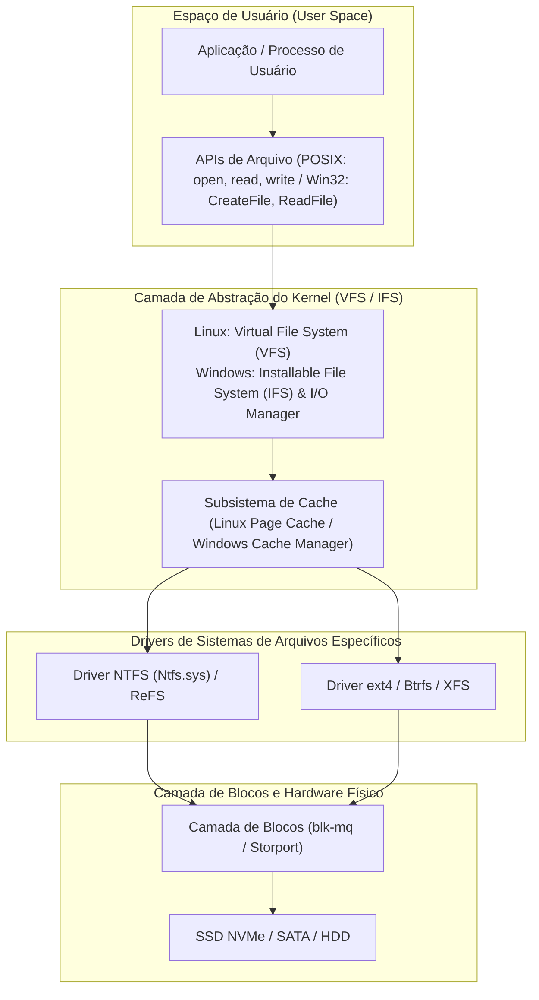
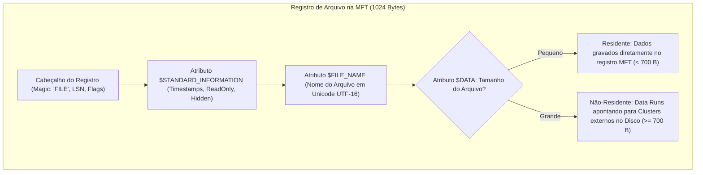
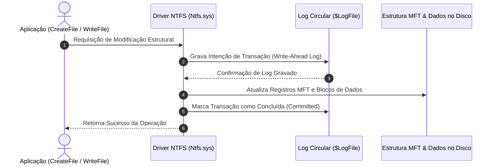

# Estudo de Caso: Sistemas de Arquivos em Sistemas Operacionais
## Análise Comparativa: Windows 11 Pro (23H2/24H2) vs. Ubuntu 24.04 LTS (Kernel Linux 6.8)

**Instituição:** Universidade Federal Rural de Pernambuco (UFRPE)  
**Departamento:** Departamento de Computação (BCC)  
**Disciplina:** Sistemas Operacionais  
**Docente:** Prof. Dr. Douglas Véras  
**Discentes (Dupla):** Luiz Maranhão & Mário Jorge  
**Data:** Outubro de 2026  

---

## 1. Introdução aos Sistemas de Arquivos nos Sistemas Operacionais

O **Sistema de Arquivos** (*File System*) é o subsistema do Sistema Operacional encarregado de estruturar, organizar, identificar, armazenar, recuperar e proteger os dados persistentes em mídias de armazenamento não volátil (SSDs, NVMe, discos rígidos magnéticos e memórias flash). 

Sem um sistema de arquivos, o disco físico seria apenas uma sequência contígua e amorfa de setores binários de 512 bytes ou 4096 bytes (Advanced Format 4Kn). O sistema de arquivos transforma essa camada física bruta em abstrações intuitivas de alto nível: **arquivos** (fluxos de bytes nomeados) e **diretórios** (estruturas de indexação hierárquica).

---

## 2. Estrutura Interna e Organização em Disco

### 2.1 O Modelo do Windows 11 Pro: NTFS (Master File Table - MFT)
O **NTFS** adota o axioma de que *"tudo no volume é um arquivo"*, inclusive as próprias estruturas de controle do sistema de arquivos:

1. **Master File Table ($MFT):** 
   - A MFT é uma tabela linear de registros de tamanho uniforme fixo (1024 bytes ou 1 KB por registro).
   - Cada arquivo ou pasta no volume possui ao menos uma entrada na MFT.
   - **Atributos Residentes vs. Não-Residentes:** Arquivos muito pequenos (normalmente menores que ~700 bytes) têm seu conteúdo gravado **diretamente dentro do registro da MFT** (residente no atributo `$DATA`). Quando o arquivo cresce, o NTFS aloca clusters fora da MFT e armazena apenas os ponteiros de extensão (*extents* ou *data runs*) dentro do registro MFT (não-residente).
2. **Indexação de Diretórios com Árvores B (B-Trees):**
   - Diretórios no NTFS não são listas lineares simples. Eles são organizados em **B-Trees balanceadas** através dos atributos `$INDEX_ROOT` e `$INDEX_ALLOCATION`, permitindo busca em tempo $O(\log n)$ mesmo em pastas contendo centenas de milhares de arquivos.

---

### 2.2 O Modelo do Ubuntu 24.04 LTS: ext4 (Inodes e Grupos de Blocos)
O **ext4** estrutura o disco físico em múltiplos **Grupos de Blocos** (*Block Groups*) contíguos para limitar a fragmentação e acelerar a busca espacial:

1. **Grupos de Blocos (Block Groups):** Cada grupo contém:
   - Cópia de segurança do Superbloco (*Superblock*) e descritores de grupo.
   - **Bitmap de Blocos:** Vetor de bits indicando blocos livres/ocupados no grupo.
   - **Bitmap de Inodes:** Vetor de bits indicando inodos livres/ocupados no grupo.
   - **Tabela de Inodes:** Conjunto de registros fixos (tipicamente 256 bytes cada).
2. **Inodes (Index Nodes):**
   - O inodo armazena todos os metadados do arquivo (tamanho, permissões `mode`, UID, GID, timestamps de precisão em nanossegundos, flags) e a árvore de **Extents**.
   - **Nomes de Arquivos:** Nomes de arquivos **não residem no inodo**; residem nas entradas de diretório (`struct ext4_dir_entry_2`), associando uma string de caracteres ao número do inodo correspondente.
3. **Indexação de Diretórios com HTree:**
   - Diretórios volumosos utilizam **HTree** (árvore balanceada indexada por hash de 32 bits dos nomes de arquivos), evitando a degradação de busca linear típica dos sistemas legados.

---

## 3. Métodos de Alocação de Espaço em Disco

| Característica / Mecanismo | Windows 11 Pro (NTFS) | Ubuntu 24.04 LTS (ext4) |
| :--- | :--- | :--- |
| **Unidade de Alocação Básica** | **Cluster** (Padrão: 4 KB = 8 setores de 512B). | **Bloco** (Padrão: 4 KB = 8 setores de 512B). |
| **Mecanismo de Alocação** | **Data Runs (Extents):** Pares ordenados de `(LCN Inicial, Quantidade de Clusters)`, mapeando blocos contíguos de forma concisa. | **Extents Modernos:** Substituição da antiga árvore de blocos indiretos; cada extent de 12 bytes mapeia até 128 MB contíguos. |
| **Alocação Tardia (*Delayed Allocation*)** | Parcial via Cache Manager (*Lazy Writer*). | **Delalloc Nativo:** O kernel adia a alocação dos blocos físicos até o momento da descarga do cache para o disco, agrupando blocos contíguos gigantescos. |
| **Rastreamento de Espaço Livre** | Arquivo de sistema **`$Bitmap`**, mantendo 1 bit por cluster do volume. | **Bitmap de Blocos** particionado localmente dentro de cada Grupo de Blocos com alocador multi-bloco (**`mballoc`**). |
| **Desfragmentação e Otimização** | Utilitário nativo `defrag.exe` agendado semanalmente (desfragmentação em HDDs e comando **TRIM** em SSDs). | **Desfragmentação Online** via utilitário `e4defrag` (com o volume montado e ativo) e serviço `fstrim.timer` semanal. |

---

## 4. Confiabilidade, Journaling e Recuperação de Falhas

### 4.1 NTFS: Write-Ahead Logging ($LogFile) e USN Journal
O NTFS garante a integridade estrutural do sistema de arquivos utilizando técnicas inspiradas em Sistemas Gerenciadores de Banco de Dados (SGBD):

- **Fase de Redo e Undo:** Caso ocorra uma queda abrupta de energia, durante o boot o driver `Ntfs.sys` examina o `$LogFile`:
  - **Fase de Redo:** Reaplica todas as transações confirmadas que não foram descarregadas no disco físico.
  - **Fase de Undo:** Desfaz operações parciais incompletas que foram interrompidas pela falha, garantindo que o sistema de arquivos nunca permaneça em estado inconsistente.
- **USN Journal ($UsnJrnl):** Registro contínuo de alterações que armazena a trilha de auditoria e modificações de todos os arquivos, permitindo que softwares de backup, busca e antivírus saibam exatamente quais arquivos foram alterados sem precisar varrer o disco inteiro.

---

### 4.2 ext4: JBD2 (Journaling Block Device 2) e Checksums CRC32c
O Linux ext4 delega o gerenciamento transacional ao subsistema de kernel **JBD2**, que oferece três níveis distintos de garantia:

1. **`data=ordered` (Padrão de Alto Desempenho e Segurança):**
   - Apenas os metadados são gravados no journal. No entanto, o kernel garante que os blocos de dados sejam fisicamente gravados no disco **antes** que a transação de metadados correspondente seja confirmada no journal. Previne que ponteiros de metadados apontem para lixo ou dados antigos após falhas.
2. **`data=journal` (Segurança Máxima):**
   - Tanto os dados brutos quanto os metadados são gravados no journal antes do disco. Elimina perda de dados, porém com sobrecarga severa de desempenho (duplo write).
3. **`data=writeback` (Desempenho Extremo):**
   - Os metadados são journalados, mas a ordem de gravação dos dados é livre, priorizando throughput.
4. **Proteção por Checksums CRC32c:** O ext4 calcula checksums criptográficos para o superbloco, entradas do journal e inodos, detectando instantaneamente corrupções causadas por falhas físicas de hardware ou controladoras defeituosas.

---

## 5. Links, Metadados e Atributos Especiais

### 5.1 Comparativo de Links e Redirecionamentos

| Tipo de Link / Redirecionamento | Windows 11 Pro (NTFS) | Ubuntu 24.04 LTS (ext4) |
| :--- | :--- | :--- |
| **Hard Link** | Aponta para o mesmo registro MFT (`mklink /H`). O arquivo só é excluído quando a contagem de referências na MFT chega a zero. Restrito ao mesmo volume. | Aponta para o mesmo número de inodo (`ln arquivo link`). Incrementa o *links count* do inodo. Restrito ao mesmo sistema de arquivos; proibido para diretórios. |
| **Symbolic Link (Soft Link)** | Arquivo especial (`mklink`) contendo o caminho textual de destino. Suporta caminhos relativos, absolutos e entre volumes diferentes. | Inodo especial (`ln -s`) com a string do caminho de destino. Se o caminho for menor que 60 bytes, é salvo inline no próprio inodo (*fast symlink*). |
| **Junction Points** | Redirecionamento exclusivo de diretórios locais via *Reparse Points* (`mklink /J`), muito utilizado para compatibilidade de caminhos legados. | Não existe separação; o Linux utiliza Symlinks de diretórios comuns ou *bind mounts* (`mount --bind`). |
| **Streams Alternativas (ADS)** | **Alternate Data Streams:** Permite associar fluxos múltiplos a um mesmo arquivo (`arquivo.txt:fluxo`). Usado pelo Windows para marcar arquivos da web (`Zone.Identifier`). | Não possui ADS nativo; utiliza **Atributos Estendidos (*xattr*)** para associar metadados arbitrários de chave-valor. |
| **Atributos de Proteção do Inode** | Atributos padrão: ReadOnly, Hidden, System, Archive. | Atributos de baixo nível (`chattr`): flag `+i` (imutável absoluto, imune a exclusão/edição) e `+a` (apenas adição / *append-only*). |

---

## 6. Quadro Sinóptico de Comandos de Diagnóstico e Gerenciamento

| Categoria de Operação | Comandos no Windows 11 Pro (PowerShell / CMD) | Comandos no Ubuntu 24.04 LTS (Bash / Terminal) |
| :--- | :--- | :--- |
| **Identificação e Montagem** | `fsutil fsinfo volumeinfo C:` `Get-Volume` | `findmnt -t ext4,btrfs` `lsblk -f` `df -hT` |
| **Inspeção de Metadados / Inodes** | `fsutil fsinfo ntfsinfo C:` `contig.exe -v "arquivo"` | `stat /caminho/arquivo` `sudo tune2fs -l /dev/nvme0n1p3` `sudo dumpe2fs -h /dev/disco` |
| **Verificação de Integridade e Reparo** | `fsutil dirty query C:` `chkdsk C: /scan` | `sudo e2fsck -fn /dev/disco` `cat /proc/mounts \| grep ext4` |
| **Criação de Links** | `mklink /H hardlink.txt destino.txt` `mklink softlink.txt destino.txt` | `ln destino.txt hardlink.txt` `ln -s destino.txt softlink.txt` |
| **Otimização e Desfragmentação** | `defrag C: /O /U /V` `Optimize-Volume -DriveLetter C -Analyze` | `sudo e4defrag -c /home` `sudo fstrim -av` |
| **Atributos Especiais e Metadados** | `Get-Item "arquivo" -Stream *` `fsutil hardlink list "arquivo"` | `sudo chattr +i /arquivo` `lsattr /arquivo` `getfattr -d /arquivo` |

---

## 7. Conclusão Comparativa

A análise aprofundada dos sistemas de arquivos revela escolhas de engenharia sofisticadas:

- O **NTFS no Windows 11** adota um projeto relacional unificado e expansível. Tratar tudo como arquivos dentro da Master File Table (MFT), indexar pastas com B-Trees e utilizar journaling de transações antecipadas com autocura online conferem ao NTFS estabilidade sólida para estações de trabalho e ambientes corporativos complexos com suporte a fluxos de dados múltiplos (ADS) e controle de acesso refinado via ACLs do NT.
- O **ext4 no Ubuntu 24.04** reflete a clássica elegância Unix aliada à alta performance moderna. A organização espacial em Grupos de Blocos, a introdução de Extents de 12 bytes, a alocação tardia (*delalloc*) e o journaling transacional com checksums CRC32c no JBD2 tornam o ext4 extremamente veloz, previsível e resistente a corrupções, sendo a escolha ideal para servidores de alto throughput e ambientes de nuvem.

---

## 8. Referências Bibliográficas (Normas ABNT)

1. BOVET, Daniel P.; CESATI, Marco. **Understanding the Linux Kernel**. 3. ed. Sebastopol: O'Reilly Media, 2005. 942 p.
2. KERRISK, Michael. **The Linux Programming Interface: A Linux and UNIX System Programming Handbook**. San Francisco: No Starch Press, 2010. 1552 p.
3. LOVE, Robert. **Linux Kernel Development**. 3. ed. Upper Saddle River: Addison-Wesley Professional, 2010. 440 p.
4. MICROSOFT CORPORATION. **NTFS Technical Reference and Architecture Overview**. Redmond: Microsoft Learn Documentation, 2024. Disponível em: <https://learn.microsoft.com/en-us/windows-server/storage/file-server/ntfs-overview>. Acesso em: 18 out. 2026.
5. RUSCHINOVICH, Mark E.; IONESCU, Alex. **Windows Internals, Part 2: Addressing Infrastructure, Storage, File Systems, and More**. 7. ed. Redmond: Microsoft Press, 2021. 768 p.
6. SILBERSCHATZ, Abraham; GALVIN, Peter Baer; GAGNE, Greg. **Operating System Concepts**. 10. ed. Hoboken: John Wiley & Sons, 2018. 1040 p.
7. STALLINGS, William. **Sistemas Operacionais: Projetos e Princípios Internos**. 7. ed. São Paulo: Pearson Education do Brasil, 2012. 792 p.
8. TANENBAUM, Andrew S.; BOS, Herbert. **Sistemas Operacionais Modernos**. 4. ed. São Paulo: Pearson Education do Brasil, 2016. 864 p.
9. THE LINUX KERNEL ORGANIZATION. **The Linux Kernel Documentation: Filesystems (ext4, VFS, JBD2)**. Release 6.8, 2024. Disponível em: <https://docs.kernel.org/filesystems/>. Acesso em: 18 out. 2026.
