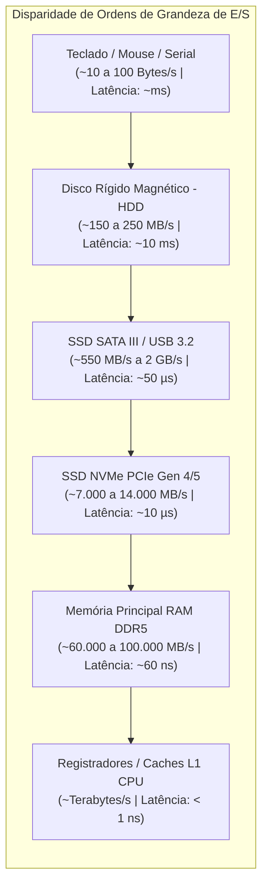
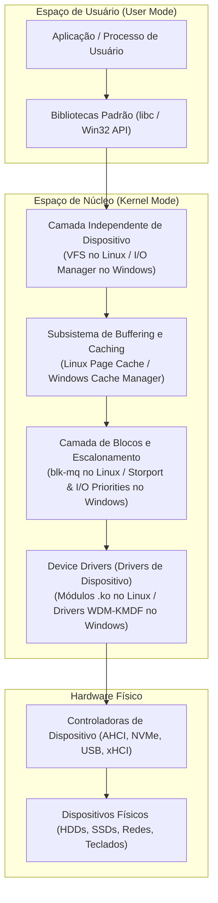
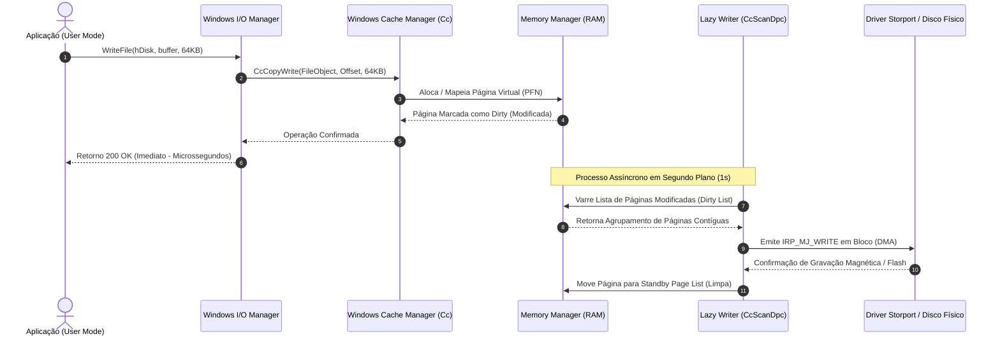
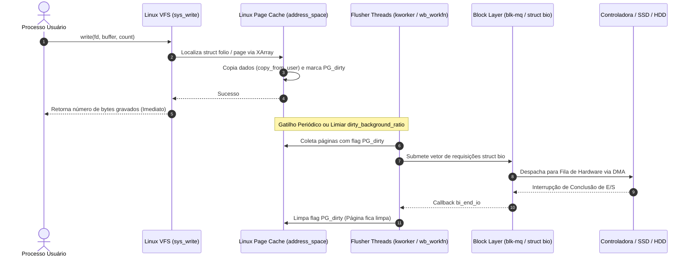
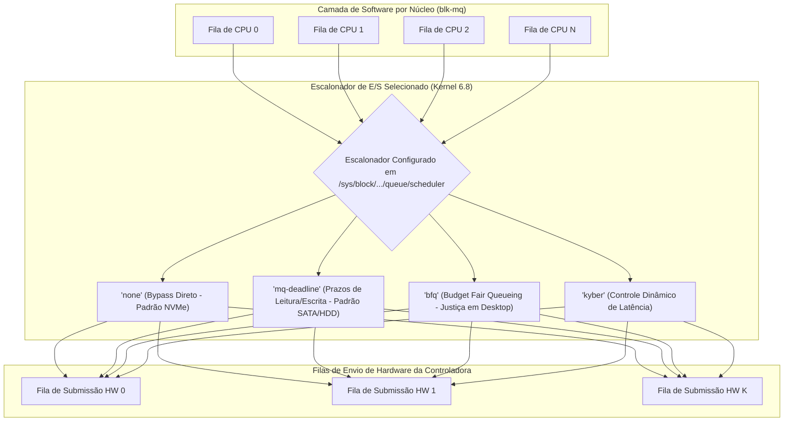

# Estudo de Caso: Subsistema de Entrada e Saída (E/S) em Sistemas Operacionais
## Análise Comparativa: Windows 11 Pro (23H2/24H2) vs. Ubuntu 24.04 LTS (Kernel Linux 6.8)

**Instituição:** Universidade Federal Rural de Pernambuco (UFRPE)  
**Departamento:** Departamento de Computação (BCC)  
**Disciplina:** Sistemas Operacionais  
**Docente:** Prof. Dr. Douglas Véras  
**Discentes (Dupla):** Luiz Maranhão & Mário Jorge  
**Data:** Outubro de 2026  

---

## 1. Introdução ao Subsistema de E/S nos Sistemas Operacionais

O gerenciamento de Entrada e Saída (E/S ou *I/O*) constitui um dos domínios mais complexos e heterogêneos no projeto de sistemas operacionais modernos. Enquanto a Unidade Central de Processamento (CPU) e a memória principal operam em frequências de gigahertz e ordens de tempo de nanossegundos, os periféricos de E/S exibem uma assombrosa disparidade de características físicas, latências de operação e taxas de transferência.

### 1.1 O Desafio da Heterogeneidade e Taxas de Transferência
Os dispositivos de E/S variam de interfaces seriais lentas (como teclados e sensores seriais transmitindo dezenas de bytes por segundo) até barramentos PCIe 5.0 conectando unidades de estado sólido NVMe e interfaces de rede de 100 Gbps, que transferem múltiplos gigabytes por segundo.

Para lidar com essa disparidade, os sistemas operacionais implementam três técnicas fundamentais de controle:
1. **E/S Programada (*Busy Waiting / Polling*):** A CPU interroga continuamente os registradores de status da controladora até que a operação seja concluída. Simples, porém desperdiça ciclos de processamento de forma crítica.
2. **E/S Dirigida por Interrupções (*Interrupt-Driven I/O*):** A CPU comanda a controladora a iniciar a operação e continua executando outras instruções. Ao terminar a transferência, o dispositivo gera uma interrupção de hardware que desvia o processador para a rotina de serviço de interrupção (ISR) do kernel.
3. **Acesso Direto à Memória (*Direct Memory Access - DMA*):** O controlador de DMA atua como mestre do barramento (*bus master*), transferindo blocos inteiros de dados diretamente entre o periférico e a memória RAM sem intermediação da CPU para cada byte, gerando apenas uma interrupção ao final do bloco completo.

---

### 1.2 Camadas de Abstração do Software de E/S
A meta central da arquitetura de E/S em qualquer SO moderno é garantir a **independência de dispositivo**: o software de usuário deve acessar um arquivo armazenado em um disco rígido mecânico, em um SSD NVMe ou em uma unidade de rede compartilhada utilizando as mesmas primitivas lógicas de leitura e gravação (`read`/`write` ou `ReadFile`/`WriteFile`).

---

## 2. Comparativo dos Sistemas Operacionais

Para o estudo de caso, foram selecionados os dois principais sistemas operacionais modernos de propósito geral em suas versões estáveis mais recentes:
- **Windows 11 Pro (versões 23H2 e 24H2)** — Representante da arquitetura microkernel híbrida baseada no núcleo NT (*New Technology*).
- **Ubuntu 24.04 LTS (Kernel Linux 6.8)** — Representante da arquitetura monolítica modular Unix/Linux de código aberto com a camada de E/S multi-fila de última geração.

---

## 3. Armazenamento em Buffer e Cache (Buffering & Caching)

### 3.1 Fundamentos: Buffering versus Caching
Embora os termos sejam frequentemente usados como sinônimos na literatura informal, em sistemas operacionais eles possuem propósitos técnicos distintos:
- **Buffer (Armazenamento Temporário):** Tem como objetivo acomodar incompatibilidades de velocidade ou de tamanho de bloco de transferência entre transmissor e receptor, e assegurar semântica de cópia atômica entre o espaço de usuário e o kernel.
- **Cache (Memória Rápida de Reuso):** Tem como objetivo armazenar cópias de dados frequentemente acessados em uma memória mais rápida (RAM) para evitar acessos repetidos ao meio lento (disco).

---

### 3.2 O Modelo no Windows 11 Pro

O Windows 11 implementa uma integração profunda entre o **I/O Manager**, o **Windows Cache Manager (Cc)** e o **Gerenciador de Memória Virtual (VMM)**.

#### Níveis de Buffering no I/O Manager
Quando um driver é registrado no Windows, ele declara como o I/O Manager deve manipular os buffers das requisições via IRPs (*I/O Request Packets*):
1. **Buffered I/O (`DO_BUFFERED_IO`):** O I/O Manager aloca um buffer intermediário na memória não paginável do kernel (*Non-Paged Pool*). Os dados são copiados da memória do processo para o buffer do kernel na escrita, e do kernel para o processo na leitura. Usado para transferências pequenas e dispositivos lentos.
2. **Direct I/O (`DO_DIRECT_IO`):** O I/O Manager constrói uma lista descritora de memória (**MDL** - *Memory Descriptor List*) que trava as páginas físicas de usuário na RAM e permite que a controladora de disco realize transferência via DMA diretamente para o espaço do usuário, sem cópia intermediária da CPU.
3. **Neither I/O:** O I/O Manager passa o ponteiro virtual de usuário diretamente ao driver, exigindo que o driver faça a validação e o mapeamento.

#### O Windows Cache Manager e o Lazy Writer
O Cache Manager opera sobre **seções de memória mapeada**. Em vez de manter um cache de blocos de disco isolado, ele mapeia visualizações (*views*) de 256 KB dos arquivos no espaço de endereçamento do sistema.
- **Gravação em Cache (*Write-Back* por padrão):** A chamada `WriteFile` aciona a rotina `CcCopyWrite`, que copia os bytes para a página na memória RAM e a marca como modificada (*dirty*). A chamada retorna sucesso instantaneamente.
- **Lazy Writer:** Uma *thread* de sistema periódica do kernel (`CcScanDpc`) desperta a cada segundo para inspecionar a quantidade de páginas modificadas. Ela agrupa blocos contíguos e emite IRPs de escrita assíncrona em bloco para o disco, prevenindo picos de saturação de barramento.
- **Read-Ahead Preditivo:** O Cache Manager monitora o padrão de leitura da aplicação. Se detectar acessos sequenciais, dispara *threads* em segundo plano que carregam páginas adjacentes na lista de espera (*Standby Page List*) antes que a aplicação as solicite.

---

### 3.3 O Modelo no Ubuntu 24.04 (Kernel Linux 6.8)

No Linux, o subsistema de buffer foi completamente unificado sob o conceito de **Linux Page Cache**. Historicamente, o Unix possuía um *Buffer Cache* (para blocos físicos de disco) e um *Page Cache* (para páginas de memória virtual). Desde a série 2.4, e consolidado no moderno Kernel 6.8, o buffer cache foi absorvido pelo Page Cache: blocos de disco são representados diretamente por páginas de 4 KB (ou as modernas **`struct folio`**, que representam conjuntos de páginas contíguas).

#### Estrutura `address_space` e XArray
Cada arquivo aberto no VFS possui um objeto `address_space`, que indexa todas as páginas em cache pertencentes ao arquivo utilizando uma estrutura de dados de busca em árvore de alta velocidade chamada **XArray** (que substituiu a antiga *Radix Tree*):
- O deslocamento no arquivo (*file offset*) é a chave de busca no XArray.
- A consulta a uma página em cache tem complexidade temporal de quase $O(1)$.

#### Mecanismo de Writeback e Flusher Threads
Quando uma chamada `write()` é executada:
1. O kernel localiza ou aloca a página correspondente no Page Cache via VFS.
2. Os dados do espaço de usuário são copiados para a página na RAM através da função `copy_from_user()`.
3. A página recebe a flag **`PG_dirty`**.
4. O processo é liberado para continuar a execução.

A descarga (*flush*) das páginas sujas para a mídia física é gerenciada de forma assíncrona pelas **flusher threads** do kernel (`kworker/u:X` executando a função `wb_workfn`). A política de writeback é governada por parâmetros expostos em `/proc/sys/vm/`:
- `vm.dirty_background_ratio` (padrão ~10%): Quando a porcentagem de memória RAM ocupada por páginas sujas atinge esse limiar, as flusher threads são acordadas em segundo plano para começar a gravar no disco.
- `vm.dirty_ratio` (padrão ~20%): Limiar crítico. Se o volume de páginas sujas atingir esse patamar, novos processos que tentarem escrever serão bloqueados (estrangulamento de E/S / *I/O throttling*) até que o cache seja esvaziado.
- `vm.dirty_expire_centisecs` (padrão 3000 = 30s): Tempo máximo que uma página pode permanecer suja na memória antes de ser forçadamente gravada.

#### Bypass de Cache: `O_DIRECT` e `O_SYNC`
Aplicações de alto desempenho (como SGBDs relacionais PostgreSQL e Oracle) que implementam seus próprios mecanismos de cache de buffer podem contornar o Page Cache:
- Flag **`O_DIRECT`**: As requisições de E/S contornam o Page Cache por completo, mapeando buffers do espaço de usuário diretamente para a camada de blocos (`blk-mq`), poupando ciclos de CPU gastos em cópias de memória duplicadas.
- Flag **`O_SYNC`**: A chamada de escrita só retorna após os dados terem sido fisicamente confirmados na mídia não volátil.

---

### 3.4 Tabela Comparativa de Buffering e Caching

| Característica / Critério | Windows 11 Pro (23H2 / 24H2) | Ubuntu 24.04 LTS (Kernel Linux 6.8) |
| :--- | :--- | :--- |
| **Entidade de Cache Central** | Windows Cache Manager (`ntoskrnl.exe!Cc`) | Linux Page Cache unificado |
| **Indexação de Arquivos em RAM** | Visualizações de Seção mapeadas (256 KB) via VMM | Estrutura `address_space` indexada por XArray |
| **Abstração de Páginas** | PFN Database (`nt!_MMPFN`) com Small Pages (4 KB) | `struct page` e **`struct folio`** (Kernel 6.8) |
| **Daemon de Escrita Atrasada** | *Lazy Writer* (`CcScanDpc`) rodando a cada 1s | *Flusher Threads* (`kworker` executando `wb_workfn`) |
| **Gatilhos de Descarga (Flush)** | Limiares de memória do VMM e chamadas `FlushFileBuffers` | Parâmetros `dirty_background_ratio`, `dirty_ratio` e `dirty_expire_centisecs` |
| **Modo de E/S sem Cópia** | *Direct I/O* via MDL (*Memory Descriptor List*) | Flag de abertura **`O_DIRECT`** |
| **Leitura Preditiva** | *Read-Ahead* preditivo automático do Cache Manager | Algoritmo *Read-Ahead* adaptativo do VFS |
| **Liberação Manual de Memória** | Esvaziamento de Working Set / Sysinternals `RAMMap` | `echo 3 > /proc/sys/vm/drop_caches` ou chamada `sync` |

---

## 4. Algoritmos de Escalonamento de Braço de Disco e Funcionamento com SSD

### 4.1 A Dinâmica Mecânica dos HDDs e o Problema do Escalonamento
Em discos rígidos magnéticos rotacionais tradicionais (HDDs), o tempo total necessário para atender uma requisição de leitura ou gravação de bloco é composto pela fórmula:
$$T_{\text{acesso}} = T_{\text{busca}} + T_{\text{latência}} + T_{\text{transferência}}$$

Onde:
- **Tempo de Busca (*Seek Time*):** O tempo para mover o braço mecânico com a cabeça de leitura/gravação radialmente até a trilha correta (ordem de 3 a 12 ms). É o maior gargalo mecânico.
- **Latência Rotacional (*Rotational Latency*):** O tempo para o setor desejado girar sob a cabeça (ordem de 2 a 6 ms em discos de 7200 a 15000 RPM).
- **Tempo de Transferência (*Transfer Time*):** O tempo para os bits do setor passarem fisicamente sob a cabeça e serem convertidos em sinal elétrico.

Para minimizar o tempo de busca, foram concebidos os algoritmos clássicos de escalonamento:
- **FCFS (*First-Come, First-Served*):** Atende por ordem de chegada. Justo, porém gera movimentos erráticos do braço.
- **SSTF (*Shortest Seek Time First*):** Seleciona a requisição mais próxima da posição atual do braço. Reduz o tempo de busca médio, mas sofre severamente de **inanição (*starvation*)** para trilhas distantes.
- **SCAN (Algoritmo do Elevador):** O braço desloca-se continuamente em uma direção atendendo todas as requisições no trajeto; ao atingir o final, inverte o sentido. Elimina o starvation.
- **C-SCAN e LOOK/C-LOOK:** Variações circulares e otimizadas que retornam rapidamente sem varrer até as bordas vazias do disco.

---

### 4.2 O Cenário no Windows 11 Pro

#### Fim do Escalonamento de Braço no SO e o Papel do NCQ
No Windows moderno, o sistema operacional **não implementa mais algoritmos geométricos de braço** (como SCAN ou SSTF) na camada de software. Essa responsabilidade foi delegada à controladora física do dispositivo:
- A interface **AHCI** (Serial ATA) e os discos modernos implementam **NCQ (Native Command Queuing)**, que permite ao próprio hardware do disco reter até 32 comandos pendentes na sua fila interna. O firmware do HDD conhece a física dos pratos, as cabeças ativas e a rotação exata em microssegundos, reordenando as requisições com precisão inalcançável pelo SO.

#### Escalonamento Baseado em Prioridades de E/S
No lugar de tentar prever o movimento mecânico da cabeça, o Windows 11 introduziu o escalonamento baseado em **Prioridades de I/O**, implementado no I/O Manager:
- **Critical (Prioridade 4):** Reservado para operações vitais do kernel (ex.: paginação de emergência).
- **High (Prioridade 3):** Usado para aplicações de tempo real e subsistemas de áudio/vídeo.
- **Normal (Prioridade 2):** Prioridade padrão para a maioria das aplicações do usuário.
- **Low (Prioridade 1):** Aplicações interativas em segundo plano.
- **Very Low / Background (Prioridade 0):** Criado para tarefas de manutenção do sistema, como o **Windows Search Indexer** e o **Windows Update**. Quando uma requisição *Normal* chega, as requisições *Very Low* têm seu envio estrangulado ou pausado, garantindo que tarefas em segundo plano nunca congelem o computador.

#### Comportamento e Otimização para SSDs e NVMes
O Windows 11 consulta a propriedade de hardware **`Seek Penalty`** da controladora:
- Se `Seek Penalty == 0`, o dispositivo é classificado como **SSD** (*Solid State Drive*).
- **Desativação de Desfragmentação Tradicional:** O Windows desativa a desfragmentação mecânica de arquivos em SSDs, pois a fragmentação lógica em memórias flash não causa perda de desempenho perceptível e gravar blocos desnecessariamente degrada a vida útil das células NAND flash.
- **Ativação Automática do TRIM:** O Windows ativa o comando TRIM (verificado via `fsutil behavior query DisableDeleteNotify`). O TRIM avisa ao controlador flash quais blocos lógicos foram excluídos pelo sistema de arquivos, permitindo que a camada de tradução de flash (**FTL** - *Flash Translation Layer*) execute o *Garbage Collection* com antecedência, evitando a penalidade de leitura-modificação-escrita (*Write Amplification*).
- **Suporte a NVMe de Alta Fila:** O driver Storport do Windows 11 mapeia requisições diretamente para as filas de submissão e conclusão do protocolo NVMe 1.4/2.0, suportando até 64.000 comandos por fila em hardware corporativo.

---

### 4.3 O Cenário no Ubuntu 24.04 (Kernel Linux 6.8)

#### A Revolução da Camada Multi-Queue (`blk-mq`)
Historicamente, o Linux utilizava uma camada de blocos de fila única (*single-queue*), onde um único *lock* global do kernel serializava todas as requisições de E/S de todas as CPUs da máquina. Esse modelo se tornou um gargalo destrutivo com a chegada dos processadores com dezenas de núcleos e SSDs capazes de realizar milhões de IOPS.

No Kernel 6.8, toda a pilha de armazenamento opera sobre o **`blk-mq`** (*Multi-Queue Block I/O Layer*):
- **Software Staging Queues:** Filas de submissão alocadas por CPU (eliminam contenção de trava entre núcleos).
- **Hardware Dispatch Queues:** Mapeadas diretamente para as filas de hardware dos controladores NVMe e SAS.

#### Escalonadores Disponíveis no Kernel 6.8
1. **`none` (Passthrough / Sem Escalonamento):**
   - Não executa nenhum cálculo ou reordenação de software. As requisições são enviadas diretamente para a fila de hardware em ordem FIFO.
   - **Padrão Absoluto para SSDs NVMe:** Como o hardware NVMe possui latência inferior a 10 µs e lida nativamente com dezenas de filas paralelas, qualquer escalonador em software introduziria overhead de CPU indesejado.
2. **`mq-deadline`:**
   - Adaptação multi-fila do clássico Deadline Scheduler. Organiza as requisições em duas filas ordenadas por setor e duas filas FIFO com prazos de expiração rígidos (padrão: 500 ms para leituras e 5 segundos para escritas).
   - Como requisições de leitura bloqueiam processos com mais frequência que escritas, as leituras recebem prioridade estrita quando se aproximam do prazo.
   - **Padrão para Discos Rígidos SATA e SSDs SATA.**
3. **`bfq` (Budget Fair Queueing):**
   - Escalonador proporcional de alta precisão derivado do algoritmo WF2Q+ (*Worst-case Fair Weighted Fair Queueing*).
   - Atribui fatias de orçamento (medidas em número de setores de disco) para cada processo ativo.
   - **Vantagem Notável:** Excelente para computadores pessoais/desktops. Garante que aplicações interativas (navegador web, reprodutor de vídeo) mantenham fluidez de interface mesmo durante a compilação pesada de código ou downloads torrent no disco.
4. **`kyber`:**
   - Criado pela Meta/Facebook especificamente para SSDs rápidos em data centers.
   - Define metas de latência (ex.: 2 ms para leitura e 10 ms para escrita). O algoritmo mede a latência em tempo real e estrangula automaticamente as filas de escrita quando as requisições de leitura correm risco de violar o objetivo de tempo de resposta.

#### Suporte e Otimização para SSDs no Ubuntu
- O kernel verifica `/sys/block/<dev>/queue/rotational`: caso o valor seja `0`, o kernel ativa regras automáticas de SSD.
- O serviço nativo **`fstrim.timer`** do systemd executa semanalmente o comando `fstrim -av`, disparando instruções TRIM para todos os pontos de montagem compatíveis.

---

### 4.4 Tabela Comparativa de Escalonamento de E/S

| Critério / Aspecto | Windows 11 Pro (23H2 / 24H2) | Ubuntu 24.04 LTS (Kernel Linux 6.8) |
| :--- | :--- | :--- |
| **Camada Arquitetural** | I/O Manager integrado ao subsistema Storport | Multi-Queue Block Layer (**`blk-mq`**) |
| **Escalonamento em HDDs** | Delegado ao hardware via **NCQ (AHCI)** | **`mq-deadline`** ou **`bfq`** |
| **Critério de Priorização** | 5 Prioridades de E/S (Very Low até Critical) | Prazos de expiração (Deadline) ou orçamentos (BFQ) |
| **Escalonador Padrão para NVMe** | Despacho direto de comandos sem reordenação | Algoritmo **`none`** (Bypass direto para fila HW) |
| **Escalonador Padrão para SATA** | Storport com balanceamento de miniport | **`mq-deadline`** |
| **Detecção de Dispositivo Flash** | Consulta SCSI/ATA: `Seek Penalty = 0` | Consulta Sysfs: `/sys/block/sdX/queue/rotational == 0` |
| **Suporte a TRIM / Descarte** | Ativo por padrão (`fsutil DisableDeleteNotify = 0`) | Gerenciado via timer semanal **`fstrim.timer`** |
| **Desfragmentação em SSDs** | Desativada automaticamente (apenas re-TRIM) | Inexistente/Desnecessária (sistemas ext4/Btrfs) |

---

## 5. Suporte a RAID (Redundant Array of Independent Disks)

### 5.1 Conceito e Níveis Fundamentais de RAID
A tecnologia RAID combina múltiplos discos físicos em uma ou mais unidades lógicas visando **desempenho** (através da distribuição de dados em faixas / *striping*), **tolerância a falhas** (através de espelhamento / *mirroring* ou paridade calculada), ou ambos:
- **RAID 0 (Striping):** Dados divididos em blocos e distribuídos alternadamente entre os discos. Desempenho máximo, redundância nula (se um disco falhar, todos os dados são perdidos).
- **RAID 1 (Mirroring):** Espelhamento exato dos dados em dois ou mais discos. Capacidade útil equivalente a um disco; tolera a falha de $N-1$ discos.
- **RAID 4:** Blocos distribuídos com paridade calculada via XOR concentrada em um único disco dedicado.
- **RAID 5:** Distribuição de blocos com paridade distribuída entre todos os discos (mínimo de 3 discos). Tolera a perda de 1 disco.
- **RAID 6:** Dupla paridade distribuída (mínimo de 4 discos). Tolera a perda simultânea de até 2 discos.
- **RAID 10 (1+0):** Combinação de espelhamento com listramento. Alta confiabilidade e alto rendimento.

---

### 5.2 Implementação no Windows 11 Pro

O Windows 11 suporta RAID em duas vertentes principais no nível de software, além de suporte irrestrito via hardware:

#### 1. Espaços de Armazenamento (*Storage Spaces*) — Tecnologia Moderna
Introduzida para substituir a tecnologia de discos dinâmicos legados, o *Storage Spaces* virtualiza o armazenamento através de **Pools de Armazenamento** (reunião de discos físicos) e **Espaços** (discos virtuais com diferentes perfis de resiliência):
- **Simples (*Simple* / RAID 0):** Distribui os dados por listras. Requer pelo menos 1 disco (recomendado 2+). Sem proteção contra falhas.
- **Espelhamento Bidirecional (*Two-Way Mirror* / RAID 1):** Mantém 2 cópias completas de todos os dados. Requer pelo menos 2 discos. Tolera a falha de 1 disco.
- **Espelhamento Tridirecional (*Three-Way Mirror*):** Mantém 3 cópias completas dos dados. Requer pelo menos 5 discos físicos. Tolera a perda simultânea de até 2 discos.
- **Paridade (*Parity* / RAID 5):** Calcula blocos de paridade distribuídos. Requer pelo menos 3 discos. Tolera a falha de 1 disco, oferecendo maior eficiência de capacidade utilizável que o espelhamento.

#### 2. Discos Dinâmicos (Gerenciador de Disco Legado)
O utilitário clássico `diskmgmt.msc` permite converter discos básicos em discos dinâmicos:
- Suporta **Volume Listrado (RAID 0)** e **Volume Espelhado (RAID 1)**.
- **Restrição Comercial:** A criação de volumes RAID 5 através de Discos Dinâmicos é desativada por software no Windows 11 Pro (sendo restrita às edições do **Windows Server**).

#### 3. RAID via Hardware
O Windows 11 oferece suporte integral e transparente a todos os níveis corporativos de RAID (0, 1, 5, 6, 10, 50, 60) implementados em controladoras RAID físicas dedicadas (como MegaRAID, Broadcom, Intel VROC/RST), gerenciados via drivers de miniport Storport certificados pela Microsoft (WHQL).

---

### 5.3 Implementação no Ubuntu 24.04 (Kernel Linux 6.8)

O suporte a RAID no Linux é historicamente reconhecido pela sua versatilidade e robustez de nível empresarial, disponibilizado através de três mecanismos nativos:

#### 1. MDADM (Módulo do Kernel `md` — Multi-Device)
O utilitário **`mdadm`** é o padrão de fato da indústria para RAID via software no ecossistema Linux:
- **Níveis Suportados Nativa e Gratuitamente:** RAID 0, RAID 1, RAID 4, RAID 5, RAID 6, RAID 10 e Linear/JBOD.
- **Flexibilidade do RAID 10:** Permite configurar layouts avançados de posicionamento de cópias:
  - `near` (cópias em setores próximos);
  - `far` (cópias com grande distanciamento radial, proporcionando desempenho de leitura similar ao RAID 0 com segurança de RAID 1);
  - `offset` (combinação híbrida de alto desempenho).
- **Recursos Avançados:** Suporte a discos de reserva (*Hot Spares*), reconstrução (*rebuild*) automática em segundo plano com controle de taxa de transferência (`/proc/sys/dev/raid/speed_limit_min`), e bitmap de reescrita para ressincronização quase instantânea após quedas de energia.

#### 2. LVM2 (Logical Volume Manager)
O LVM moderno integra o módulo de kernel `dm-raid` (*Device-Mapper*):
- Permite criar volumes lógicos com tolerância a falhas utilizando parâmetros como `lvcreate --type raid1` ou `lvcreate --type raid5`.
- Permite converter dinamicamente volumes simples para volumes espelhados sem desmontar o sistema de arquivos.

#### 3. Sistemas de Arquivos Modernos com RAID Integrado (Btrfs e ZFS)
O Ubuntu 24.04 suporta sistemas de arquivos modernos de próxima geração com RAID nativo em nível de bloco:
- **Btrfs:** Suporte nativo do kernel com comandos de balanceamento para RAID 0, RAID 1, RAID 1C3 (3 cópias), RAID 1C4 (4 cópias) e RAID 10, com validação de integridade por *checksum* CRC32c/BLAKE2b e autocura (*self-healing*) automática de setores corrompidos durante a leitura.
- **OpenZFS no Linux:** Suporte a arranjos RAIDZ1 (equivalente a RAID 5), RAIDZ2 (equivalente a RAID 6), RAIDZ3 (tripla paridade) e espelhamentos complexos, imunes ao problema clássico da *Write Hole* de paridade.

---

### 5.4 Tabela Comparativa de Suporte a RAID

| Nível de RAID / Recurso | Windows 11 Pro (23H2 / 24H2) | Ubuntu 24.04 LTS (Kernel Linux 6.8) |
| :--- | :--- | :--- |
| **Tecnologia Principal de Software** | Espaços de Armazenamento (*Storage Spaces*) | Utilitário **`mdadm`** (Módulo `md` do Kernel) |
| **RAID 0 (Striping)** | Sim (Volume Simples / Storage Spaces) | Sim (`mdadm --level=0` / LVM2) |
| **RAID 1 (Mirroring)** | Sim (Espelhamento bidirecional / 2-way mirror) | Sim (`mdadm --level=1` / LVM2 / Btrfs) |
| **Espelhamento Tridirecional** | Sim (Espelhamento 3-way no Storage Spaces) | Sim (RAID 1 com 3 cópias / Btrfs RAID 1C3) |
| **RAID 4 (Paridade Única)** | Não suportado diretamente | Sim (`mdadm --level=4`) |
| **RAID 5 (Paridade Distribuída)** | Sim (Resiliência de Paridade no Storage Spaces) | Sim (`mdadm --level=5` / LVM2 RAID 5) |
| **RAID 6 (Dupla Paridade)** | Sim (Storage Spaces Parity com discos adicionais) | Sim (`mdadm --level=6` com Reed-Solomon) |
| **RAID 10 (1 + 0)** | Sim (Agrupamento no Storage Spaces) | Sim (`mdadm --level=10` com modos near/far) |
| **RAID em Sistemas de Arquivos** | Não integrado nativamente (NTFS é agnóstico) | **Sim (Btrfs e OpenZFS com autocura nativa)** |
| **Suporte a RAID por Hardware** | Suporte total via drivers certificados WHQL | Suporte nativo a controladoras corporativas |
| **Restrições Comerciais** | RAID 5 legado bloqueado no Gerenciador de Disco | **Totalmente livre, sem restrições de edição** |

---

## 6. Lista de Comandos Principais e Ferramentas Práticas

### 6.1 Comandos e Ferramentas no Windows 11 Pro

| Categoria | Comando / Ferramenta | Descrição Técnica e Sintaxe de Uso |
| :--- | :--- | :--- |
| **Diagnóstico de SSD** | `fsutil behavior query DisableDeleteNotify` | Consulta o status global do comando TRIM no sistema operacional (`0` = Ativo / `1` = Desativado). |
| **Otimização de Disco** | `Optimize-Volume -DriveLetter C -ReTrim -Verbose` | Executa o comando de re-TRIM forçado em unidades de estado sólido ou desfragmentação em HDDs mecânicos via PowerShell. |
| **Inspeção de Hardware** | `Get-PhysicalDisk \| Select DeviceId, FriendlyName, MediaType, BusType` | Exibe se as unidades conectadas são detectadas como SSD ou HDD mecânico e a interface de conexão (NVMe, SATA, USB). |
| **Particionamento** | `diskpart` | Utilitário de linha de comando para manipulação de partições MBR/GPT, volumes dinâmicos e atribuição de letras. |
| **Gerenciamento RAID** | `Get-StoragePool`; `Get-VirtualDisk` | Inspeciona os conjuntos de discos e unidades de armazenamento virtuais criadas pelo subsistema de *Storage Spaces*. |
| **Monitoramento Tempo Real** | `Get-Counter '\Disco Físico(*)\Avg. Disk sec/Transfer' -Continuous` | Mede continuamente a latência de transferência de E/S do disco físico em milissegundos. |
| **Atividade do Cache** | `Get-Counter '\Cache\Lazy Write Flushes/sec'` | Monitora a taxa por segundo de descargas de blocos em memória executadas pelo *Lazy Writer* para o disco. |
| **Interface Gráfica (GUI)** | `resmon.exe` (Monitor de Recursos) | Aba 'Disco': Apresenta gráficos em tempo real de processos ativos, tempo de resposta em milissegundos e tamanho da fila de E/S. |
| **Ferramenta Sysinternals** | `procmon.exe` (Process Monitor) | Captura e inspeciona em tempo de execução cada operação de E/S em nível de thread e IRP despachado pelo kernel. |
| **Mapeamento de Blocos** | `DiskView.exe` (Sysinternals) | Apresenta a disposição visual de clusters e setores gravados na superfície geométrica do disco. |

---

### 6.2 Comandos e Ferramentas no Ubuntu 24.04 LTS (Kernel Linux 6.8)

| Categoria | Comando / Ferramenta | Descrição Técnica e Sintaxe de Uso |
| :--- | :--- | :--- |
| **Listagem de Dispositivos** | `lsblk -e 7 -o NAME,SIZE,TYPE,FSTYPE,MOUNTPOINTS` | Lista todos os dispositivos de bloco e sistemas de arquivos, filtrando dispositivos loop gerados por pacotes Snap. |
| **Escalonador de E/S** | `cat /sys/block/sdX/queue/scheduler` | Exibe o escalonador de E/S atualmente ativo (entre colchetes) para o dispositivo especificado. |
| **Alteração do Escalonador** | `echo 'bfq' \| sudo tee /sys/block/sdX/queue/scheduler` | Altera dinamicamente o algoritmo de escalonamento do disco em tempo de execução sem reiniciar o sistema. |
| **Tipo de Mídia (SSD/HDD)** | `cat /sys/block/sdX/queue/rotational` | Retorna `0` caso o disco seja detectado como não rotacional (SSD/NVMe) e `1` para discos rígidos mecânicos. |
| **Comando TRIM Manual** | `sudo fstrim -v -a` | Executa a liberação de blocos não utilizados em todos os pontos de montagem compatíveis com SSD. |
| **Monitoramento Avançado** | `iostat -xz 1 5` | Apresenta estatísticas detalhadas de E/S da camada de blocos (r/s, w/s, latência média *await* em ms e porcentagem de uso *%util*). |
| **Top de Processos de E/S** | `sudo iotop -only` | Utilitário interativo que monitora em tempo real apenas os processos que estão consumindo largura de banda de disco no instante. |
| **Saúde Física (SMART)** | `sudo smartctl -a /dev/nvme0n1` | Emite relatório completo de saúde física do disco, temperatura, setores defeituosos realocados e bytes gravados. |
| **Criação de RAID 5** | `sudo mdadm --create /dev/md0 --level=5 --raid-devices=3 /dev/sdb /dev/sdc /dev/sdd` | Cria um arranjo de RAID 5 via software com paridade distribuída entre 3 unidades de disco pelo terminal. |
| **Status do Arranjo RAID** | `cat /proc/mdstat` | Inspeciona em tempo de execução o status operacional de todos os arranjos de RAID ativos e o progresso de sincronização/rebuild. |
| **Estatísticas de Cache** | `cat /proc/meminfo \| grep -E 'Cached\|Buffers\|Dirty'` | Exibe a quantidade exata de memória RAM dedicada ao Page Cache, Buffers de metadados e páginas sujas pendentes de gravação. |
| **Descarga Forçada de Cache** | `sync; echo 3 \| sudo tee /proc/sys/vm/drop_caches` | Força a sincronização imediata de todas as páginas sujas para o disco e limpa os caches de páginas de memória limpas. |

---

## 7. Conclusão da Análise Comparativa

A comparação aprofundada entre o **Windows 11 Pro** e o **Ubuntu 24.04 LTS** evidencia abordagens arquiteturais distintas, porém ambas extremamente refinadas para resolver os desafios do gerenciamento de E/S contemporâneo:

1. **Abstração e Gerenciamento de Buffer:**
   - O Windows 11 destaca-se pelo modelo fortemente integrado entre o *I/O Manager*, o *Windows Cache Manager* e o *Gerenciador de Memória Virtual*, utilizando seções mapeadas de 256 KB e o daemon *Lazy Writer* para assegurar excelente fluidez de interface e isolamento em ambientes de desktop corporativo.
   - O Ubuntu 24.04 (Kernel 6.8) brilha pela elegância do seu **Page Cache unificado**, onde arquivos e metadados compartilham a mesma infraestrutura de páginas (e `struct folio`) indexadas pela estrutura XArray, oferecendo controle granular e programável sobre as rotinas de writeback (`flusher threads`) e alto rendimento com suporte a `O_DIRECT` e `io_uring`.

2. **Escalonamento em Discos Mecânicos versus SSDs:**
   - Ambos os sistemas convergiram para a constatação física de que **o escalonamento geométrico de braço mecânico tornou-se obsoleto no nível do sistema operacional**: em discos magnéticos, a ordenação foi delegada ao hardware via NCQ/AHCI; em SSDs e NVMes, o tempo de busca nulo torna qualquer reordenação prejudicial.
   - O Windows implementa uma abordagem elegante focada em **Prioridades de E/S** (estrangulando processos em background como o Windows Update para privilegiar a aplicação do usuário).
   - O Linux inovou radicalmente com a arquitetura **`blk-mq`** (filas de submissão por CPU), oferecendo escalonadores altamente especializados: o algoritmo `none` para máxima vazão em NVMes, o `bfq` para interatividade superior em desktops e o `mq-deadline` para previsibilidade de prazos.

3. **Tecnologia de RAID:**
   - O Windows 11 oferece o moderno ecossistema *Storage Spaces*, que abstrai o hardware em pools e discos virtuais com interfaces gráficas intuitivas para o usuário final, mantendo restrições intencionais de licenciamento para certas funções legadas (como RAID 5 em discos dinâmicos).
   - O Ubuntu 24.04 é imbatível em termos de flexibilidade e poder de armazenamento: o utilitário `mdadm` entrega suporte irrestrito a todos os níveis de RAID conhecidos (incluindo RAID 6 com dupla paridade e RAID 10 com layouts variados), complementado pelo suporte de ponta a sistemas de arquivos modernos como Btrfs e ZFS, capazes de detectar corrupção silenciosa de dados e realizar autocura em tempo real.

---

## 8. Referências Bibliográficas

1. **BOVET, Daniel P.; CESATI, Marco.** *Understanding the Linux Kernel*. 3. ed. Sebastopol: O'Reilly Media, 2005. 942 p.
2. **CORBET, Jonathan; RUBINI, Alessandro; KROAH-HARTMAN, Greg.** *Linux Device Drivers*. 3. ed. Sebastopol: O'Reilly Media, 2005. 636 p.
3. **KERNEL.ORG.** *The Linux Kernel Documentation: Block Layer (blk-mq) and Multi-Queue I/O Schedulers*. Release 6.8. Disponível em: <https://docs.kernel.org/block/>. Acesso em: 11 out. 2026.
4. **LOVE, Robert.** *Linux Kernel Development*. 3. ed. Upper Saddle River: Addison-Wesley, 2010. 440 p. (Capítulo 13: The Virtual Filesystem; Capítulo 14: The Block I/O Layer; Capítulo 16: The Page Cache and Page Writeback).
5. **MICROSOFT CORPORATION.** *Windows Hardware Developer: Storage Driver Architecture & Storport Miniports*. Microsoft Learn Documentation, 2024. Disponível em: <https://learn.microsoft.com/en-us/windows-hardware/drivers/storage/>. Acesso em: 11 out. 2026.
6. **PATTERSON, David A.; GIBSON, Garth; KATZ, Randy H.** *A Case for Redundant Arrays of Inexpensive Disks (RAID)*. In: ACM SIGMOD International Conference on Management of Data, 1988, Chicago. Proceedings... New York: ACM, 1988. p. 109-116.
7. **RUSSINOVICH, Mark E.; SOLOMON, David A.; IONESCU, Alex.** *Windows Internals, Part 2: Addressing Infrastructure, Storage, File Systems, and More*. 7. ed. Redmond: Microsoft Press, 2021. 960 p.
8. **SILBERSCHATZ, Abraham; GALVIN, Peter Baer; GAGNE, Greg.** *Operating System Concepts*. 10. ed. Hoboken: John Wiley & Sons, 2018. 1264 p. (Capítulo 13: I/O Systems; Capítulo 14: Mass-Storage Structure).
9. **STALLINGS, William.** *Sistemas Operacionais: Projetos e Princípios Internos*. 7. ed. São Paulo: Pearson Education do Brasil, 2012. 752 p. (Capítulo 11: Gerenciamento de E/S e Escalonamento de Disco).
10. **TANENBAUM, Andrew S.; BOS, Herbert.** *Sistemas Operacionais Modernos*. 4. ed. São Paulo: Pearson Education do Brasil, 2016. 864 p. (Capítulo 5: Entrada/Saída; Capítulo 10: Estudo de Caso 1: Unix, Linux e Android; Capítulo 11: Estudo de Caso 2: Windows).
