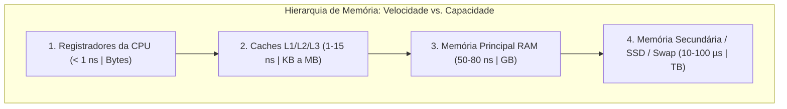
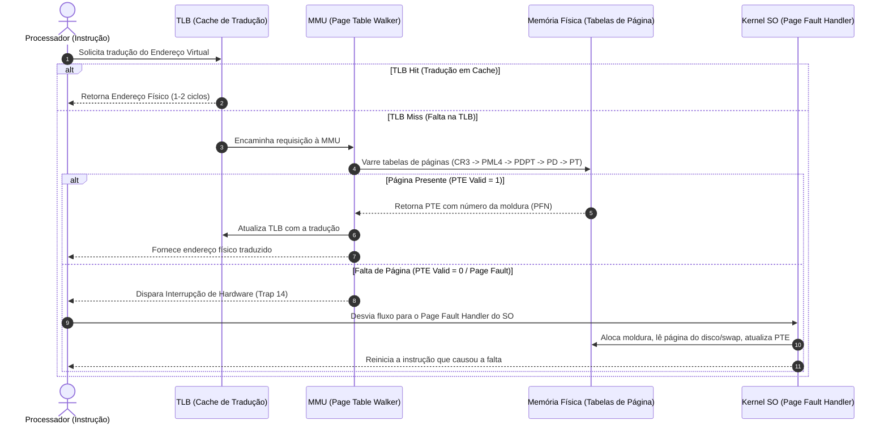

# Estudo de Caso: Gerenciamento de Memória em Sistemas Operacionais
## Análise Comparativa: Windows 11 Pro (23H2/24H2) vs. Ubuntu 24.04 LTS (Kernel Linux 6.8)

**Instituição:** Universidade Federal Rural de Pernambuco (UFRPE)  
**Departamento:** Departamento de Computação (BCC)  
**Disciplina:** Sistemas Operacionais  
**Docente:** Prof. Dr. Douglas Véras  
**Discentes (Dupla):** Luiz Maranhão & Mário Jorge  
**Data:** Setembro de 2026  

---

## 1. Introdução ao Gerenciamento de Memória

### 1.1 Hierarquia de Memória e o Princípio da Localidade
O subsistema de gerenciamento de memória constitui um dos pilares mais sofisticados da ciência da computação e dos sistemas operacionais modernos. Em qualquer arquitetura computacional, existe um dilema físico e econômico inescapável conhecido como a **Hierarquia de Memória**:
- **Registradores da CPU:** Tempo de acesso de frações de nanossegundo (~0.5 ns), capacidade na ordem de centenas de bytes.
- **Memórias Cache (L1, L2 e L3):** Construídas com SRAM estática integrada à pastilha do processador; latência de 1 a 15 ns, capacidade entre poucos kilobytes e dezenas de megabytes.
- **Memória Principal (RAM - DRAM):** Latência de aproximadamente 50 a 80 ns, capacidade na faixa de gigabytes (ex.: 16 GB a 128 GB).
- **Memória Secundária (SSDs NVMe, SATA e Discos Rígidos):** Dispositivos de bloco não voláteis; latência de dezenas a centenas de microssegundos em SSDs e milissegundos em discos magnéticos (HDDs), com capacidade na faixa de terabytes.



Como a memória RAM física é um recurso finito e substancialmente mais lento que a CPU (porém ordens de grandeza mais rápida que os discos de armazenamento secundário), os sistemas operacionais modernos exploram o **Princípio da Localidade**:
1. **Localidade Temporal:** Se uma instrução ou dado foi referenciado em um dado instante, há uma probabilidade expressiva de que seja referenciado novamente em um futuro próximo (ex.: laços de repetição `for`/`while`, variáveis contadoras, pilha de chamadas).
2. **Localidade Espacial:** Se um endereço de memória foi acessado, os endereços contíguos adjacentes possuem alta probabilidade de serem requisitados logo a seguir (ex.: percurso sequencial de vetores, execução linear de código binário).

---

### 1.2 Memória Real versus Memória Virtual
Nos primórdios da computação e em sistemas embarcados simples, utilizava-se **alocação contígua real**: o programa era carregado diretamente em endereços físicos de memória. Essa abordagem impunha restrições severas:
- Nenhum programa podia exceder a capacidade física da memória RAM instalada.
- O isolamento entre programas dependia de registradores de base e limite frágeis.
- A multiprogramação gerava intensa fragmentação externa.

A introdução da **Memória Virtual** resolveu essas barreiras ao criar uma camada de abstração elegante:
- O processador opera sobre um **Espaço de Endereçamento Virtual** linear privativo para cada processo (no x86-64, uma faixa canônica gigantesca de múltiplos terabytes a petabytes).
- O espaço virtual é fragmentado em blocos uniformes de tamanho fixo denominados **Páginas Virtuais** (geralmente 4 KB).
- A memória física (RAM) é dividida em blocos de idêntico tamanho chamados **Quadros de Página** (*Page Frames* ou molduras).
- O programa executa mantendo apenas as páginas estritamente necessárias em memória física (o chamado *Working Set* ou conjunto residente). Páginas inativas podem residir em armazenamento secundário (*Swap* / Arquivo de Paginação) e ser carregadas sob demanda.

---

### 1.3 O Papel da MMU e do TLB
A tradução de endereços virtuais (gerados pelo software) para endereços físicos (transmitidos ao barramento de memória) não é realizada pelo kernel em software a cada instrução (o que destruiria o desempenho), mas por hardware especializado: a **MMU** (*Memory Management Unit*), integrada à CPU.



Para acelerar a MMU, a CPU possui o **TLB** (*Translation Lookaside Buffer*), uma memória associativa ultrarrápida que guarda as traduções de páginas mais recentes. Se a tradução estiver na TLB (*TLB Hit*), ela é resolvida em ~1 ciclo de clock. Caso contrário (*TLB Miss*), a MMU realiza a travessia na tabela de páginas na RAM (*Page Table Walk*). Se a página não estiver mapeada na RAM física (bit `Valid = 0`), a CPU gera uma exceção de **Falta de Página** (*Page Fault*), transferindo o controle ao kernel para que este busque os dados do arquivo de swap ou mapeamento de arquivo em disco.

---

### 1.4 Objetivos Fundamentais do Gerenciamento de Memória
1. **Isolamento e Segurança Estrita:** Cada processo reside em sua própria bolha de endereçamento virtual. O hardware assegura que um processo não possa ler ou corromper a memória de outro processo nem do espaço protegido do Kernel (Ring 0).
2. **Prevenção contra Execução Indevida (NX/DEP):** Através do bit NX (*No-Execute*) na tabela de páginas, o SO impede a execução de instruções a partir da pilha (*stack*) ou do *heap*, mitigando ataques de transbordamento de buffer (*buffer overflow*).
3. **Compartilhamento Econômico de Recursos:** Código executável de bibliotecas dinâmicas compartilhadas (DLLs no Windows, arquivos `.so` no Linux) é carregado em uma única moldura física de RAM e mapeado simultaneamente nos espaços virtuais de dezenas de processos.
4. **Cópia em Escrita (*Copy-on-Write* - COW):** Durante a criação de processos (ex.: chamada `fork()` no Linux), as páginas de dados não são duplicadas imediatamente; ambas as tabelas apontam para as mesmas molduras em modo somente-leitura. Uma nova moldura física só é alocada se um dos processos tentar modificar os dados.
5. **Alocação Sob Demanda (*Demand Paging*):** A memória física só é efetivamente reservada e associada à tabela de páginas quando o primeiro byte do bloco é acessado em tempo de execução, economizando RAM.

---

## 2. Visão Geral dos Sistemas Operacionais Comparados

Para este estudo de caso, foram selecionadas as duas plataformas corporativas e de desenvolvimento mais utilizadas na computação contemporânea de 64 bits:

| Dimensão Arquitetural | Windows 11 Pro (23H2 / 24H2) | Ubuntu 24.04 LTS (Noble Numbat) |
| :--- | :--- | :--- |
| **Kernel e Versão** | Windows NT Kernel 10.0 (Build 22631 / 26100) | Linux Kernel 6.8.0-xx-generic |
| **Família de SO** | Windows NT (Microkernel Híbrido) | Unix-like / POSIX (Kernel Monolítico Modular) |
| **Arquitetura de CPU** | x86-64 (AMD64 / Intel 64) | x86-64 (AMD64 / Intel 64) |
| **Espaço de Endereçamento** | 128 TB Usuário / 128 TB Kernel (4 níveis) | 128 TB Usuário / 128 TB Kernel (expansível a 64 PB / 5 níveis) |
| **Divisão de Privilégios** | Ring 0 (Kernel/Executivo) e Ring 3 (User) | Ring 0 (Kernel Space) e Ring 3 (User Space) |
| **Alocador Padrão de User-Space** | Windows Segment Heap / LFH | glibc `ptmalloc3` (GNU C Library) |
| **Alocador Padrão de Kernel** | Paged & Non-Paged Pools / Lookaside | Buddy System (páginas) & SLUB (objetos) |
| **Substituição de Páginas** | Working Set Trimming + Standby List (8 prioridades) | Relógio de Duas Listas + MGLRU (Multi-Gen LRU) |

---

## 3. Matriz Comparativa Detalhada (As 6 Dimensões)

### 3.1 Paginação (Paging)
A paginação é o alicerce da memória virtual nos dois sistemas operacionais em arquitetura x86-64.

#### Windows 11 Pro
- **Esquema Multinível:** Utiliza a paginação de 4 níveis padrão x86-64 (PML4 $\rightarrow$ PDPT $\rightarrow$ PD $\rightarrow$ PT $\rightarrow$ PTE), permitindo endereçar 256 TB de espaço virtual (128 TB para o espaço de usuário e 128 TB para o espaço do sistema). Há suporte implementado para paginação de 5 níveis (PML5 / LA57) em plataformas de servidores e processadores modernos.
- **Tamanhos de Página:**
  - *Small Page (Base):* 4 KB (utilizada para a grande maioria das alocações).
  - *Large Page:* 2 MB (habilitável via chamada `VirtualAlloc` com a flag `MEM_LARGE_PAGES`; requer o privilégio `SeLockMemoryPrivilege`).
  - *Huge Page:* 1 GB (usada para hipervisor Hyper-V e mapeamentos especiais de hardware).
- **Estruturas de Dados do Kernel:**
  - **PTE (Page Table Entry):** Entrada de 64 bits contendo o PFN (*Page Frame Number*), bit *Valid* (presente na RAM), bit *Write*, bit *User/Supervisor*, bit *Accessed*, bit *Dirty* e bit NX (*No-Execute* / DEP).
  - **PFN Database (`nt!_MMPFN`):** Estrutura fundamental mantida como um array contíguo indexado pelo número do quadro físico na RAM. Cada entrada `_MMPFN` rastreia o estado da moldura: *Active/Valid* (em uso por um Working Set), *Standby* (página limpa pronta para reuso mas mantendo cache), *Modified* (página alterada aguardando gravação em disco), *ModifiedNoWrite*, *Free* (livre e não inicializada), *Zeroed* (livre e preenchida com zeros para segurança) e *Bad* (quadro com falha de hardware).
  - **Working Set List (`nt!_MMWSL`):** Rastreia as páginas virtuais de cada processo que estão atualmente mapeadas e residentes na memória física.

#### Ubuntu 24.04 LTS (Kernel Linux 6.8)
- **Esquema Multinível:** Utiliza uma arquitetura abstrata de tabelas de páginas em árvore de 4 níveis (PGD $\rightarrow$ P4D $\rightarrow$ PUD $\rightarrow$ PMD $\rightarrow$ PTE) e suporte completo a 5 níveis compilado por padrão (`CONFIG_X86_5LEVEL=y`), permitindo até 128 PB de espaço virtual.
- **Tamanhos de Página:**
  - *Página Regular:* 4 KB.
  - *Transparent Huge Pages (THP):* Páginas transparentes de 2 MB agrupadas dinamicamente pelo kernel sem que a aplicação precise ser modificada, reduzindo drasticamente as faltas na TLB para processos com uso intensivo de memória.
  - *HugeTLB:* Suporte estático a páginas de 2 MB e 1 GB reservadas no boot para aplicações de alto desempenho (bancos de dados PostgreSQL/Oracle, KVM/QEMU).
- **Estruturas de Dados do Kernel:**
  - **`struct page` e `struct folio`:** Cada moldura de 4 KB de RAM física possui um descritor `struct page` de 64 bytes. No Kernel 6.8, a abstração moderna **`struct folio`** agrupa uma ou mais páginas contíguas gerenciadas como uma unidade atômica, eliminando redundâncias de contabilidade em Huge Pages. Rastreia contagem de referências (`_refcount`), mapa de uso (`_mapcount`) e flags de estado (`PG_locked`, `PG_active`, `PG_dirty`, `PG_lru`).
  - **`mm_struct`:** Estrutura associada à `task_struct` do processo que descreve seu espaço de memória, contendo o ponteiro para o diretório de páginas raiz (`pgd_t *pgd`), cujo endereço físico é carregado no registrador de controle **CR3** da CPU durante trocas de contexto.
  - **`vm_area_struct` (VMA):** Mapeia intervalos contíguos de páginas virtuais com as mesmas permissões (leitura, escrita, execução, compartilhamento). No Kernel 6.8, as VMAs são indexadas por uma **Maple Tree** (estrutura de dados B-tree concorrente otimizada para cache RCU, substituindo a antiga árvore Red-Black).

---

### 3.2 Segmentação (Segmentation)

#### Cenário Universal do x86-64
Em modo de compatibilidade de 64 bits (*Long Mode*), tanto a Intel quanto a AMD desativaram o mecanismo clássico de segmentação de hardware em favor de um **Modelo de Memória Plana** (*Flat Memory Model*). Os registradores de segmento tradicionais de código (`CS`), dados (`DS`), pilha (`SS`) e extras (`ES`) têm sua base travada em zero e seus limites de segmento são completamente ignorados pelo processador. O espaço de memória é visto como um único vetor linear e contíguo de 64 bits.

No entanto, a arquitetura reservou expressamente dois registradores de segmento — **`FS`** e **`GS`** — para uso estratégico dos sistemas operacionais, permitindo definir bases lineares de 64 bits independentes para apontar para estruturas essenciais de thread e CPU.

#### Windows 11 Pro
- **Uso do Registrador `GS`:** O Windows 11 padronizou o uso estrito do registrador `GS` para gerenciar contextos:
  - **Em Modo Usuário (Ring 3):** `GS` aponta para o **TEB** (*Thread Environment Block*). Por exemplo, `GS:[0x30]` aponta para o próprio TEB, e `GS:[0x60]` aponta diretamente para o **PEB** (*Process Environment Block*), permitindo que threads acessem rapidamente suas variáveis locais de thread (TLS), identificador de thread (TID) e limites da pilha sem chamadas de sistema dispendiosas.
  - **Em Modo Kernel (Ring 0):** `GS` aponta para a estrutura **KPCR** (*Kernel Processor Control Region*). A instrução `swapgs` é disparada na transição de privilégio (syscall/interrupção), trocando instantaneamente a base de `GS` para o KPCR do núcleo físico atual, onde ficam ponteiros para a thread ativa (`CurrentThread`), descritores de interrupção (IDT) e filas DPC.
- **Tabelas de Descritores:** A GDT (*Global Descriptor Table*) é mantida com descritores mínimos de código e dados para Ring 0 e Ring 3. A LDT (*Local Descriptor Table*) não é utilizada por processos nativos de 64 bits.

#### Ubuntu 24.04 LTS (Kernel Linux 6.8)
- **Uso dos Registradores `FS` e `GS`:** O Linux distribuiu as responsabilidades de forma distinta:
  - **Registrador `FS` (Espaço de Usuário):** Dedicado à biblioteca padrão C (`glibc` / biblioteca de threads NPTL) para endereçar o **TLS** (*Thread-Local Storage*). Variáveis globais declaradas com `__thread` em C/C++ são lidas via `%fs:offset` em tempo constante $O(1)$.
  - **Registrador `GS` (Espaço de Kernel):** Dedicado exclusivamente ao kernel para gerenciar variáveis **`per-CPU`**. O ponteiro `current` (que referencia a `task_struct` do processo em execução no núcleo atual), contadores estatísticos e pilhas de tratamento de interrupções de hardware são endereçados via `%gs:offset`. A instrução assembly `swapgs` alterna a base de `GS` na entrada e saída de interrupções e chamadas de sistema.
  - **Instruções `FSGSBASE`:** O Linux habilita as instruções de CPU `rdfsbase`, `wrfsbase`, `rdgsbase` e `wrgsbase`, permitindo que aplicações em espaço de usuário alterem a base do registrador `FS` sem necessidade de realizar a dispendiosa chamada de sistema `arch_prctl()`.
- **GDT e LDT:** A GDT possui entradas estáticas mínimas (`__KERNEL_CS = 0x10`, `__KERNEL_DS = 0x18`, `__USER_CS = 0x33`, `__USER_DS = 0x2b`) e o descritor TSS (*Task State Segment*) para tabelas IST de pilha de interrupções. A LDT pode ser instanciada sob demanda caso uma aplicação legada de 32 bits ou camada de compatibilidade (ex.: Wine para rodar jogos do Windows) requisite a syscall `modify_ldt()`.

---

### 3.3 Swap e Paginação Secundária (Swap & Paging)

#### Windows 11 Pro
- **Arquivos de Paginação:**
  - `pagefile.sys`: Arquivo oculto na raiz da unidade do sistema (ou discos secundários) que recebe páginas anônimas de dados e pilha modificadas que precisam ser desalojadas da RAM.
  - `swapfile.sys`: Arquivo específico introduzido para dar suporte à suspensão e hibernação de aplicativos da plataforma UWP (*Universal Windows Platform*) e pacotes MSIX da Windows Store em segundo plano.
- **Compactação de Memória na RAM (*Memory Compression*):**
  - Em vez de transferir páginas frias diretamente para o disco rígido ou SSD (o que causa latência e degradação de gravação em células flash NAND), o Windows 11 compacta as páginas modificadas na própria memória física.
  - As páginas comprimidas ficam armazenadas em uma área gerenciada no processo denominado **`System`** (ou exibido como *Memory Compression*).
  - Quando a página é requisitada novamente, ela é descompactada em frações de microssegundo pela CPU, eliminando o I/O de disco.
- **Modified Page Writer:** Threads do kernel do Windows que monitoram a lista de páginas modificadas e gravam blocos contíguos de páginas no `pagefile.sys` em lotes (*clustering*), otimizando a taxa de transferência de escrita.
- **Commit Limit:** A quantidade máxima de memória virtual que os processos podem alocar simultaneamente é a soma da RAM física com a capacidade atual dos arquivos `pagefile.sys`. Se o *Commit Charge* atingir o *Commit Limit*, novas alocações são rejeitadas.

#### Ubuntu 24.04 LTS (Kernel Linux 6.8)
- **Partições e Arquivos de Swap:**
  - O Ubuntu 24.04 adota por padrão um arquivo de swap dinâmico (`/swapfile`) de 2 GB a 4 GB criado na raiz da instalação, mas suporta partições dedicadas formatadas com tipo de partição swap.
- **Tecnologias de Swap Comprimido em RAM:**
  - **zRAM:** Cria um dispositivo de bloco virtual na RAM comprimido em tempo real através de algoritmos de alta eficiência (como *zstd*, *lz4* ou *lzo*). O Ubuntu pode direcionar o swap prioritariamente para o `/dev/zram0`, duplicando ou triplicando a capacidade efetiva da memória volátil antes de tocar no SSD.
  - **zswap:** Atua como um cache frontal comprimido para dispositivos de swap em disco. Quando uma página vai ser transferida para o swap, o zswap tenta comprimi-la e armazená-la em um pool na RAM; apenas se o pool estiver saturado a página é gravada no disco.
- **Parâmetro `vm.swappiness`:**
  - Valor inteiro entre 0 e 200 (padrão 60). Controla o quão agressivamente o kernel substitui páginas anônimas de processos (enviando-as para o swap) em comparação com o descarte de páginas de arquivos em cache (*Page Cache*). Em servidores de bancos de dados, costuma ser reduzido para 10 ou 1 para priorizar a memória de processos ativos.
- **OOM Killer (*Out-of-Memory Killer*):**
  - Se a memória física e a área de swap esgotarem por completo, o kernel Linux não trava a máquina; ele aciona o algoritmo do OOM Killer. O kernel calcula uma pontuação de consumo (`badness score` visível em `/proc/<PID>/oom_score`) e elimina sumariamente o processo causador da saturação através do sinal `SIGKILL`, restaurando o equilíbrio do sistema.

---

### 3.4 Partições Fixas ou Variáveis e Estruturas de Alocação

#### Análise Conceitual
Tanto o Windows 11 quanto o Ubuntu 24.04 utilizam **PARTIÇÕES VARIÁVEIS** no nível lógico de alocação de processos e estruturas do kernel. Nenhum sistema operacional de propósito geral moderno divide a memória em partições de tamanho fixo para programas (técnica abandonada desde a década de 1970 por causar severa fragmentação interna). No nível de hardware mais baixo, a paginação divide a RAM em molduras físicas uniformes de 4 KB, sobre as quais os subsistemas constroem alocações de tamanho variável sob demanda.

#### Windows 11 Pro
- **Estruturas de Heap em Espaço de Usuário:**
  - **Segment Heap:** Alocador de heap moderno introduzido para mitigar o consumo de memória em aplicações complexas e navegadores. Divide as alocações em sub-segmentos de páginas e utiliza **Mapas de Bits** (*Bitmaps*) para controlar quais slots estão livres ou ocupados.
  - **Low Fragmentation Heap (LFH):** Camada do NT Heap que minimiza fragmentação externa dividindo requisições menores que 16 KB em centenas de *buckets* de tamanhos predeterminados. Quando uma aplicação aloca memória, o bloco é obtido diretamente da fila de blocos do tamanho solicitado.
  - **Listas Duplamente Encadeadas (`LIST_ENTRY`):** Conectam blocos livres em listas ordenadas dentro dos heaps tradicionais e nos descritores de controle de memória.
- **Pools de Memória do Kernel:**
  - **Paged Pool:** Região do espaço de endereçamento do kernel alocada dinamicamente em partições variáveis para estruturas que podem ser paginadas para o disco quando a RAM estiver sob escassez.
  - **Non-Paged Pool:** Região de partições variáveis que tem garantia absoluta de residir na RAM física em tempo integral (nunca pode ser paginada). É reservada para estruturas acessadas em níveis de interrupção elevados (IRQL $\ge$ DISPATCH_LEVEL), como manipuladores de interrupção (ISRs) e rotinas DPC.

#### Ubuntu 24.04 LTS (Kernel Linux 6.8)
- **Estruturas de Alocação do Kernel:**
  - **Buddy System (Sistema de Parceiros Binários):** É o coração do gerenciamento de páginas físicas do kernel Linux. Ele gerencia blocos de páginas contíguas em ordens de potências de 2 ($2^0, 2^1, \dots, 2^{10}$ páginas, correspondendo a blocos de 4 KB até 4 MB). Utiliza listas encadeadas circulares duplas (`struct list_head`) para cada ordem e mapas de bits para determinar o estado de cada bloco "parceiro" (*buddy*).
  - **Alocador SLUB:** Construído sobre o Buddy System para resolver a alocação de estruturas de dados do kernel com tamanhos menores que uma página de 4 KB (ex.: descritores de arquivos `struct file`, nós VFS `struct inode`, descritores de processos `struct task_struct`). O SLUB substituiu o antigo SLAB e SLOB: organiza páginas inteiras em contêineres de objetos idênticos e mantém uma *freelist* encadeada embutida dentro dos próprios objetos não alocados, alcançando alocações em tempo constante $O(1)$ sem fragmentação externa.
- **Espaço de Usuário (glibc `ptmalloc3`):**
  - O alocador padrão da biblioteca C no Ubuntu organiza o heap do processo em blocos contíguos de tamanho variável denominados *chunks*. Cada bloco possui metadados com seu tamanho e flags de estado (se o bloco anterior está livre para fusão).
  - Os blocos livres são indexados em listas encadeadas circulares organizadas em categorias (*bins*):
    - *Fastbins:* Listas simplesmente encadeadas LIFO para blocos muito pequenos (alocações e liberações quase instantâneas).
    - *Smallbins:* Listas duplamente encadeadas FIFO para blocos de tamanho fixo moderado.
    - *Unsorted bin:* Lista de retenção temporária onde blocos recém-liberados aguardam reutilização rápida antes de serem categorizados.
    - *Largebins:* Listas ordenadas por tamanho para blocos maiores, permitindo fusão de espaços contíguos.

---

### 3.5 Algoritmos de Alocação de Memória

#### Windows 11 Pro
- **Segregated Free Lists (Listas Livres Segregadas):**
  - É o algoritmo central utilizado pelo **LFH** para alocações de até 16 KB. Em vez de percorrer a memória procurando um espaço que caiba o pedido, o sistema mantém vetores de listas livres categorizados por faixas estritas de tamanho. A requisição de $N$ bytes é mapeada matematicamente para o índice correspondente, realizando a alocação em tempo constante $O(1)$.
- **Best-Fit e First-Fit em Heaps Tradicionais:**
  - Para alocações de tamanho intermediário que não se enquadram nas classes do LFH, o Windows aplica algoritmos de busca em listas encadeadas de blocos livres:
    - *Best-Fit:* Localiza o menor bloco livre que seja suficiente para comportar os dados solicitados, minimizando o resíduo restante.
    - *First-Fit:* Aloca o primeiro bloco livre encontrado com capacidade suficiente, priorizando a velocidade da busca.
- **Coalescência Imediata (*Immediate Free Block Merging*):**
  - Quando um bloco é liberado via `HeapFree`, o Windows verifica imediatamente os cabeçalhos dos blocos fisicamente adjacentes à esquerda e à direita. Se estiverem livres, funde-os instantaneamente em um único bloco maior para combater a fragmentação externa.
- **VirtualAlloc para Alocações Gigantes:**
  - Alocações que excedem limites de centenas de kilobytes bypassam o heap do processo e solicitam diretamente páginas inteiras à MMU do sistema operacional, arredondadas para múltiplos de 4 KB ou 2 MB.

#### Ubuntu 24.04 LTS (Kernel Linux 6.8)
- **Algoritmo do Buddy System (Kernel):**
  - Quando o kernel solicita um bloco de $2^k$ páginas contíguas, o algoritmo verifica a lista livre da ordem $k$:
    1. Se houver um bloco disponível, ele é concedido imediatamente.
    2. Se a lista estiver vazia, o algoritmo busca um bloco na ordem superior $k+1$ e o divide em dois blocos parceiros (*buddies*) de ordem $k$. Um dos parceiros é entregue e o outro é colocado na lista livre da ordem $k$. Essa divisão ocorre recursivamente até satisfazer a ordem demandada.
    3. Na desalocação, o endereço do parceiro é obtido instantaneamente por uma operação bit a bit XOR (`endereco ^ (tamanho_bloco)`). Se o parceiro estiver livre, ambos são fundidos imediatamente (*coalescing*) em um bloco de ordem superior em tempo $O(1)$.
- **Algoritmo do Alocador SLUB:**
  - O SLUB mantém caches dedicados para tipos de estruturas específicas. A alocação é puramente atômica em $O(1)$: o ponteiro de retorno é o topo da *freelist* local da CPU, sem nenhuma varredura linear.
- **Algoritmos da glibc (`ptmalloc3` em User-Space):**
  - *Exact-Fit:* Empregado para blocos de tamanho exato nos *Fastbins* e *Smallbins*.
  - *First-Fit:* Empregado ao examinar o *Unsorted Bin* para reaproveitar blocos liberados recentemente.
  - *Best-Fit Aproximado:* Empregado nos *Largebins*, onde os blocos livres são mantidos ordenados decrescentemente; o alocador busca o menor bloco suficiente para minimizar resíduos de espaço.

---

### 3.6 Algoritmos de Substituição de Páginas (Page Replacement)

#### Windows 11 Pro
- **Working Set Trimming (Local + Global):**
  - Cada processo no Windows possui uma cota elástica de páginas na RAM delimitada por um *Working Set Mínimo* e *Máximo*. O componente do kernel denominado **Balance Set Manager** acorda periodicamente (a cada 1 segundo) ou quando o sistema detecta escassez de memória física.
  - O gerenciador analisa os processos e "apara" (*trims*) as páginas excedentes que não foram acessadas recentemente, desmarcando o bit de validade na tabela de páginas e movendo-as para as listas de transição.
- **Aproximação de LRU via Aging e Bits de Acesso:**
  - A CPU marca o bit *Accessed* na PTE toda vez que uma página é lida ou modificada. O Windows inspeciona esse bit e incrementa ou decrementa contadores de idade (*aging counter*), permitindo identificar com precisão páginas frias que podem ser substituídas.
- **Standby Page List com 8 Níveis de Prioridade (0 a 7):**
  - Uma página limpa removida de um processo não é descartada imediatamente; ela é movida para a **Standby Page List**.
  - A Standby List é estruturada em 8 níveis de prioridade (de 0 a 7):
    - *Prioridade 0-2:* Dados secundários e utilitários em segundo plano.
    - *Prioridade 5:* Código de aplicações interativas normais em primeiro plano.
    - *Prioridades 6 e 7:* Código crítico do núcleo do sistema e serviços de segurança.
  - **Soft Page Fault:** Se um processo requisitar novamente uma página que estava na Standby List antes que outro processo a reutilize, o kernel simplesmente reativa a entrada na tabela de páginas sem nenhuma leitura em disco, resolvendo a falta em microssegundos.
  - Se a memória RAM esgotar, o alocador retira páginas da Standby List começando pela prioridade 0 (as mais frias e de menor prioridade).
- **Modified Page List & SuperFetch (SysMain):**
  - Páginas modificadas vão para a *Modified Page List*, onde aguardam o *Modified Page Writer* descarregá-las no disco antes de irem para a Standby List.
  - O serviço **SysMain (SuperFetch)** aprende a rotina do usuário (horários de abertura de navegadores, softwares de escritório) e pré-carrega preditivamente páginas frequentes na Standby List nos horários usuais.

#### Ubuntu 24.04 LTS (Kernel Linux 6.8)
- **Algoritmo Clássico de Relógio de Duas Listas (*Active / Inactive Lists*):**
  - O Linux historicamente implementou uma aproximação elegante do algoritmo **LRU** baseada no **Algoritmo de Relógio de Segunda Chance** (*Two-Handed Clock Algorithm*), separando páginas em duas listas encadeadas:
    - *Inactive List:* Páginas candidatas à expulsão ou swap.
    - *Active List:* Páginas comprovadamente ativas e acessadas com frequência.
  - Quando uma página é carregada pela primeira vez, ela entra na *Inactive List*. Se for acessada novamente enquanto reside nessa lista (bit `PG_referenced` ativado), é promovida para a *Active List*.
  - Sob pressão de memória, o daemon do kernel **`kswapd`** acorda e varre a *Active List*, despromovendo páginas que não tiveram acessos recentes de volta para a *Inactive List*. As páginas no final da *Inactive List* são recicladas: se forem de arquivo limpo (*Page Cache*), são descartadas; se forem anônimas ou sujas, são gravadas no swap.
- **Inovação no Kernel 6.8: MGLRU (*Multi-Generational Least Recently Used*):**
  - No Ubuntu 24.04 LTS, o Kernel 6.8 traz habilitada a tecnologia revolucionária **MGLRU** (`CONFIG_LRU_GEN=y`).
  - O MGLRU supera os gargalos das listas clássicas de LRU (que exigiam travamento pesado de mutexes e varreduras completas de árvores de tabelas de páginas em servidores com múltiplos terabytes de RAM).
  - O MGLRU divide as páginas da memória física em **múltiplas gerações etárias** (*Generations*), criando faixas temporais como camadas de uma cebola:
    - As páginas mais novas nascem na geração atual.
    - Conforme o tempo passa e a pressão de memória aumenta, gerações antigas são avançadas.
    - O sistema cria histogramas de frequência de acesso em múltiplos níveis (*tiers*), diferenciando páginas que são acessadas esporadicamente de páginas acessadas continuadamente.
  - **Resultados Práticos:** O MGLRU reduz o consumo de CPU durante escassez de memória em até **80%**, elimina travamentos de interface gráfica em desktops sob carga de compilação pesada e melhora em ordens de magnitude o tempo de resposta do sistema sob saturação de RAM.

---

## 4. Transcrição Fiel da Planilha Comparativa Oficial

A tabela abaixo reproduz fidedignamente o conteúdo preenchido na planilha oficial `.xlsx` solicitada na atividade:

| Sistema Operacional / Comparativo | Windows 11 Pro (23H2 / 24H2) | Windows 11 Pro – comandos (CLI ou passo-a-passo GUI) | Ubuntu 24.04 LTS (Kernel Linux 6.8) | Ubuntu 24.04 LTS – comandos (CLI ou passo-a-passo GUI) |
| :--- | :--- | :--- | :--- | :--- |
| **O SO utiliza paginação? Como é feito? (ex.: dados de uma página, tamanho da página, estrutura de dados, etc.)** | • Sim, utiliza paginação multinível x86-64 com 4 níveis padrão (PML4 $\rightarrow$ PDPT $\rightarrow$ PD $\rightarrow$ PT $\rightarrow$ PTE) e suporte a 5 níveis (PML5 / LA57).<br>• Páginas de 4 KB (padrão), Large Pages de 2 MB (VirtualAlloc + MEM_LARGE_PAGES) e Huge Pages de 1 GB para hipervisor.<br>• Estruturas: PTE de 64 bits com bits Valid/Dirty/NX; PFN Database (`nt!_MMPFN`) rastreando o estado de cada moldura física; Working Set (`nt!_MMWSL`) por processo. | • **CLI (PowerShell):**<br>`Get-Process \| Select-Object Name, Id, WorkingSet64, VirtualMemorySize64 \| Sort-Object WorkingSet64 -Descending`<br>• **Sysinternals:** `rammap.exe` e `vmmap.exe`<br>• **GUI (resmon.exe):** Monitor de Recursos > Guia 'Memória' (gráfico de uso físico, Standby, Livre e Modificada).<br>• **GUI:** Gerenciador de Tarefas > Desempenho > Memória. | • Sim, paginação multinível em árvore com 4 níveis (PGD $\rightarrow$ P4D $\rightarrow$ PUD $\rightarrow$ PMD $\rightarrow$ PTE) e suporte nativo a 5 níveis (até 128 PB virtuais).<br>• Páginas base de 4 KB; Transparent Huge Pages (THP) de 2 MB automáticas; HugeTLB de 1 GB estático.<br>• Estruturas: `struct page` / `struct folio` rastreando `_refcount`, `_mapcount` e flags; `mm_struct` associada ao CR3; `vm_area_struct` (VMA) indexada por Maple Tree. | • **CLI:** `getconf PAGESIZE` (exibe 4096 bytes).<br>• **CLI:** `pmap -x <PID>` ou `cat /proc/<PID>/smaps`.<br>• **CLI:** `cat /sys/kernel/mm/transparent_hugepage/enabled`<br>• **CLI:** `grep -i hugepages /proc/meminfo`<br>• **GUI:** `gnome-system-monitor` > Processos > Clique direito > Mapas de Memória. |
| **O SO utiliza segmentação? Como é feito? (ex.: dados de um segmento, tipos de segmento, estrutura de dados, etc.)** | • Opera sob o Modelo de Memória Plana (*Flat Model*) em x86-64. Seletores CS, DS, ES e SS têm base em zero e limites ignorados pela CPU.<br>• Registrador **GS** é utilizado estrategicamente:<br>  - Em Ring 0 aponta para a **KPCR** (*Kernel Processor Control Region*).<br>  - Em Ring 3 aponta para o **TEB** (*Thread Environment Block*, `GS:[0x30]`), que ancora o PEB.<br>• GDT mantém descritores estáticos mínimos; LDT desativada. | • **CLI (WinDbg):** `r gs, r cs, r ss; !pcr; !teb`<br>• **CLI (PowerShell):** `Get-Process \| Format-Table Id, Name, BasePriority, HandleCount`<br>• **GUI (Process Explorer):** Propriedades do Processo > Threads > Stack (revela endereços base do TEB/stack ancorados por GS). | • Opera sob o *Flat Memory Model* em 64 bits (base zero e limites desconsiderados pelo processador).<br>• GDT mínima com seletores essenciais (`__KERNEL_CS`, `__USER_CS`, etc.) e TSS para pilhas de interrupção (IST).<br>• Registrador **FS** aponta para o TLS (*Thread-Local Storage*) em espaço de usuário (glibc).<br>• Registrador **GS** aponta para dados `per-CPU` no kernel (instrução `swapgs`). LDT opcional via `modify_ldt()`. | • **CLI:** `dmesg \| grep -i -E 'gdt\|segments\|fsgsbase'`<br>• **CLI (GDB):** `gdb -p <PID> -batch -ex 'info registers fs gs cs ss'`<br>• **CLI:** `grep CONFIG_MODIFY_LDT_SYSCALL /boot/config-$(uname -r)`<br>• **GUI:** `gnome-system-monitor` demonstra espaço linear de endereçamento uniforme contínuo. |
| **O SO faz uso Swap? Como é feito? (ex.: estrutura de dados, gerenciamento, etc.)** | • Sim, faz uso de arquivos de paginação (`pagefile.sys` principal e `swapfile.sys` para apps UWP).<br>• **Compactação de Memória na RAM:** Comprime páginas frias no processo *System* antes de realizar I/O em disco.<br>• Estruturas: `MMPAGING_FILE` com bitmaps de blocos de disco livres.<br>• Threads *Modified Page Writer* realizam gravação em lote (*clustering*) para otimizar velocidade de gravação. | • **CLI (PowerShell):**<br>`Get-CimInstance Win32_PageFileUsage \| Select-Object Name, AllocatedBaseSize, CurrentUsage`<br>• **CLI:** `Get-Process -Name 'System' \| Select WS, PrivateMemorySize`<br>• **GUI:** `sysdm.cpl` > Avançado > Desempenho > Avançado > Memória Virtual (Alterar).<br>• **GUI:** Gerenciador de Tarefas > Desempenho > Memória ('Confirmado' e 'Compactada'). | • Sim, através de `/swapfile` dinâmico ou partições dedicadas (tipo 82 swap).<br>• Suporta swap comprimido na RAM: **zRAM** (disco virtual de blocos comprimido por zstd/lz4) e **zswap** (cache de compressão frontal).<br>• Estrutura `swap_info_struct` controlando prioridades e setores.<br>• Parâmetro `vm.swappiness` regula propensão ao swap.<br>• **OOM Killer:** Elimina tarefas com maior `oom_score` sob exaustão. | • **CLI:** `swapon --show` ou `cat /proc/swaps`<br>• **CLI:** `free -h`<br>• **CLI:** `cat /proc/sys/vm/swappiness` (ajuste: `sudo sysctl vm.swappiness=10`)<br>• **CLI:** `sudo fallocate -l 4G /swapfile && sudo mkswap /swapfile && sudo swapon /swapfile`<br>• **GUI:** `gnome-system-monitor` > Guia 'Recursos' (gráfico de uso de Swap). |
| **O SO utiliza partições fixas ou variáveis? Quais técnicas/estruturas de alocação são utilizadas (ex.: bit map, lista encadeada, etc.)?** | • Utiliza **PARTIÇÕES VARIÁVEIS** dinâmicas em nível de processos e heaps (sobre molduras de paginação de 4 KB).<br>• **Segment Heap e LFH:** Dividem memória em baldes (*buckets*) para requisições de até 16 KB.<br>• **Mapas de Bits (`RtlBitmap`):** Rastreiam slots livres em sub-segmentos e setores no pagefile.<br>• **Listas Duplamente Encadeadas (`LIST_ENTRY`):** Conectam blocos livres de heap.<br>• Pools: *Paged Pool* (paginável) e *Non-Paged Pool* (residente garantido em RAM). | • **CLI (PowerShell):**<br>`Get-CimInstance Win32_OperatingSystem \| Select TotalVisibleMemorySize, FreePhysicalMemory`<br>• **Sysinternals:** `coreinfo.exe -m` (topologia NUMA); `vmmap.exe <PID>`.<br>• **GUI:** Gerenciador de Tarefas > Desempenho > Memória (exibe 'Pool paginável' e 'Pool não paginável').<br>• **GUI:** `perfmon.msc` (contadores Memory\Pool Paged Bytes). | • Utiliza **PARTIÇÕES VARIÁVEIS** para alocação a processos e estruturas do kernel.<br>• **Buddy System:** Gerencia páginas físicas em potências de 2 ($2^0$ a $2^{10}$ páginas) usando listas duplamente encadeadas circulares (`struct list_head`) e bitmaps.<br>• **Alocador SLUB:** Aloca objetos do kernel em contêineres de tamanho fixo com freelist embutida em $O(1)$.<br>• **glibc `ptmalloc3`:** Heap do usuário organizado em blocos variáveis com arenas e categorias de *bins*. | • **CLI (Buddy System):** `cat /proc/buddyinfo` (blocos contíguos livres por ordem $2^k$).<br>• **CLI (SLUB):** `sudo slabtop -s c` ou `cat /proc/slabinfo`<br>• **CLI:** `cat /proc/meminfo \| grep -E 'Slab\|SReclaimable'`<br>• **GUI:** `gnome-system-monitor` > Processos (monitoramento dinâmico de RSS/VIRT). |
| **Quais algoritmos de alocação são utilizados (ex.: first-fit, best-fit, etc.)?** | • **Segregated Free Lists em $O(1)$:** Utilizado pelo LFH para alocações até 16 KB; acesso imediato por índice sem busca linear.<br>• **Best-Fit e First-Fit:** No NT Heap e Segment Heap para blocos médios e grandes em listas encadeadas.<br>• **Coalescência Imediata:** Fusão instantânea de blocos vizinhos ao liberar memória.<br>• **Lookaside Lists:** Listas LIFO ultrarrápidas no kernel sem travas pesadas.<br>• **VirtualAlloc Direta:** Alocações > 512 KB alocam páginas inteiras da MMU. | • **CLI (WinDbg):** `!heap -s` (status de LFH/Segment Heap); `!heap -p -a <Endereço>`.<br>• **CLI (PowerShell):** `Get-Process \| Where {$_.NonpagedSystemMemorySize64 -gt 10MB}`<br>• **Process Hacker:** Propriedades > Guia 'Heaps' (inspeção de blocos livres/alocados).<br>• **GUI:** `perfmon.msc` (contadores Heap Locks e Committed Bytes). | • **Buddy System Binário:** Aloca blocos de potências de 2; divide blocos recursivamente e funde parceiros por operação XOR na liberação em tempo $O(1)$.<br>• **Alocação Exata SLUB:** Retira diretamente o topo da freelist para objetos fixos do kernel.<br>• **glibc `ptmalloc3`:**<br>  - *Exact-Fit* para *Fastbins* e *Smallbins*.<br>  - *First-Fit* para o *Unsorted Bin*.<br>  - *Best-Fit Aproximado* para os *Largebins* (listas ordenadas). | • **CLI:** `cat /proc/buddyinfo` (audita blocos disponíveis do Buddy System).<br>• **CLI:** `vmstat -m` (estatísticas dos caches de alocação do kernel).<br>• **CLI:** `ltrace -e malloc+free ls` (rastreia chamadas da biblioteca C).<br>• **CLI:** `valgrind --tool=massif ls` (análise aprofundada de heap).<br>• **GUI:** `gnome-system-monitor` (avaliação de estabilidade contra memory leaks). |
| **Quais algoritmos de substituição de páginas são utilizados (ex.: LRU, FIFO, etc.)?** | • **Working Set Trimming:** Balance Set Manager reduz páginas de processos excedentes.<br>• **Aproximação de LRU com Aging:** Inspeciona bit *Accessed* da PTE e decrementa contadores de idade.<br>• **Standby Page List em 8 Prioridades (0 a 7):** Páginas removidas ficam em espera; requisitadas geram *Soft Page Fault* instantâneo. Descarte inicia pela prioridade 0.<br>• **Modified Page List:** Páginas sujas gravadas em lote.<br>• **SysMain / SuperFetch:** Pré-carregamento heurístico preditivo. | • **CLI (PowerShell):**<br>`Get-Counter '\Memory\Page Faults/sec', '\Memory\Transition Faults/sec'`<br>• **Sysinternals:** `rammap.exe` > Guia 'Priority Summary' (detalha níveis 0 a 7 do Standby Cache).<br>• **GUI:** `perfmon.msc` (`\Memory\Pages/sec` e `\Memory\Page Writes/sec`).<br>• **GUI:** Gerenciador de Tarefas > Desempenho > Memória (campo 'Em cache'). | • **Relógio de Duas Listas (*Active / Inactive Lists*):** Aproximação clássica de LRU baseada no Algoritmo de Relógio de Segunda Chance via daemon `kswapd`.<br>• **MGLRU (*Multi-Gen LRU*) no Kernel 6.8:** Divide páginas em múltiplas gerações temporais com histogramas de acesso de múltiplos níveis; reduz em até 80% o uso de CPU durante pressão de memória e previne engasgos de I/O.<br>• **Page Cache Reclaim:** Páginas limpas descartadas imediatamente. | • **CLI (MGLRU):** `cat /sys/kernel/mm/lru_gen/enabled` (confirma status no Kernel 6.8).<br>• **CLI:** `grep -E 'Active\|Inactive' /proc/meminfo`<br>• **CLI:** `vmstat 1 5` (monitora colunas si/so e trocas de páginas).<br>• **CLI:** `sar -B 1 5` (taxas de page fault e reclaim via sysstat).<br>• **GUI:** `gnome-system-monitor` > Recursos (gráficos de cache e swap). |

---

## 5. Roteiro Consolidado de Comandos Práticos e Ferramentas

### 5.1 No Windows 11 Pro

#### 1. Inspecionar Consumo Global de Memória Virtual e Física via PowerShell
```powershell
Get-CimInstance Win32_OperatingSystem | Select-Object @{Name="TotalRAM_GB"; Expression={[math]::round($_.TotalVisibleMemorySize/1MB,2)}}, @{Name="FreeRAM_GB"; Expression={[math]::round($_.FreePhysicalMemory/1MB,2)}}, @{Name="TotalVirtual_GB"; Expression={[math]::round($_.TotalVirtualMemorySize/1MB,2)}}, @{Name="FreeVirtual_GB"; Expression={[math]::round($_.FreeVirtualMemory/1MB,2)}}
```
*Saída típica esperada:*
```text
TotalRAM_GB FreeRAM_GB TotalVirtual_GB FreeVirtual_GB
----------- ---------- --------------- --------------
      15.78       5.21           18.28           6.14
```

#### 2. Obter Arquivos de Paginação e Taxa de Utilização
```powershell
Get-CimInstance Win32_PageFileUsage | Select-Object Name, AllocatedBaseSize, CurrentUsage, PeakUsage
```
*Saída típica esperada:*
```text
Name            AllocatedBaseSize CurrentUsage PeakUsage
----            ----------------- ------------ ---------
C:\pagefile.sys              2560          284       412
```

#### 3. Avaliar Taxa de Faltas de Página e Transições (Soft Faults)
```powershell
Get-Counter '\Memory\Page Faults/sec', '\Memory\Transition Faults/sec', '\Memory\Page Reads/sec' -SampleInterval 2 -MaxSamples 3
```

#### 4. Ferramentas do Microsoft Sysinternals
- **RAMMap (`rammap.exe`):** Ferramenta definitiva para análise forense da memória RAM no Windows. Apresenta o PFN Database visualmente, discriminando o espaço ocupado por cada uma das 8 listas de prioridade da *Standby List*, além da *Modified List*, *Process Working Sets* e pools do kernel.
- **VMMap (`vmmap.exe`):** Permite anexar a qualquer processo e visualizar o layout completo de seu espaço de endereçamento virtual de 64 bits, discriminando segmentos de Heap, Pilha (*Stack*), Mapeamentos de Arquivos, Imagens de DLLs e blocos com proteção NX/DEP.

---

### 5.2 No Ubuntu 24.04 LTS (Kernel Linux 6.8)

#### 1. Diagnóstico Rápido de Memória RAM e Swap
```bash
free -h
```
*Saída típica esperada:*
```text
               total        used        free      shared  buff/cache   available
Mem:            15Gi       4.2Gi       5.8Gi       412Mi       5.5Gi        10Gi
Swap:          4.0Gi       256Mi       3.7Gi
```

#### 2. Inspecionar Detalhes do Kernel e Alocadores via `/proc/meminfo`
```bash
grep -E "MemTotal|MemAvailable|Active|Inactive|SwapTotal|SwapFree|Slab|HugePages_Total" /proc/meminfo
```
*Saída típica esperada:*
```text
MemTotal:       16315804 kB
MemAvailable:   11245800 kB
Active:          4251200 kB
Inactive:        3840120 kB
Active(anon):    2120400 kB
Inactive(anon):   350100 kB
Active(file):    2130800 kB
Inactive(file):  3490020 kB
SwapTotal:       4194300 kB
SwapFree:        3932156 kB
Slab:             685400 kB
HugePages_Total:       0
```

#### 3. Auditar a Disponibilidade de Blocos do Buddy System
```bash
cat /proc/buddyinfo
```
*Saída típica esperada (mostra número de blocos contíguos de $2^0$ a $2^{10}$ páginas livres):*
```text
Node 0, zone      DMA      1      0      1      0      2      1      1      0      1      1      3 
Node 0, zone    DMA32   1420   1210    850    620    310    150     82     40     21      9     12 
Node 0, zone   Normal   4210   3100   2150   1400    780    390    180     92     45     18     35 
```

#### 4. Inspecionar e Ajustar o Multi-Generational LRU (MGLRU)
```bash
cat /sys/kernel/mm/lru_gen/enabled
# Retorna normalmente 0x0007 (E-Cache habilitada para múltiplas gerações)
```

#### 5. Monitorar Caches de Alocação de Objetos com `slabtop`
```bash
sudo slabtop -s c
```
*Permite visualizar interativamente em tempo real quais estruturas do kernel (ex.: `dentry`, `inode_cache`, `task_struct`, `vm_area_struct`) estão consumindo os slabs alocados pelo SLUB.*

---

## 6. Conclusões e Síntese dos Trade-offs de Engenharia

A análise aprofundada do gerenciamento de memória no Windows 11 Pro e no Ubuntu 24.04 LTS revela uma fascinante dualidade da engenharia de software moderno:

1. **Convergência Estrutural por Imposição de Hardware:**  
   Em nível de arquitetura de processador x86-64, ambos os sistemas operacionais convergem de forma quase idêntica: utilizam paginação multinível em árvore de 4 e 5 níveis, adotam páginas de 4 KB com suporte a Huge Pages de 2 MB, abandonaram a segmentação clássica em favor do Modelo Plano (*Flat Memory Model*) e reaproveitaram os registradores `FS` e `GS` para resolver eficientemente Thread-Local Storage e variáveis de controle do núcleo.

2. **Divergência Filosófica nos Alocadores:**  
   - O **Windows 11** adota uma abordagem altamente orientada a granularidades de usuário e tolerância a padrões caóticos de desktop, valendo-se do *Segment Heap* e do *LFH* categorizado em dezenas de buckets fixos para neutralizar fragmentação externa, aliando a isso o suporte à memória compactada no processo *System* para preservar baterias e SSDs de computadores portáteis.
   - O **Ubuntu 24.04 (Linux 6.8)** prioriza desempenho máximo, matemática de binários e escalabilidade massiva de contêineres e servidores. O alinhamento rigoroso por potências de 2 do *Buddy System*, a agilidade $O(1)$ do *SLUB* e o modelo de arenas do *ptmalloc3* minimizam a contenção entre threads em servidores de alta densidade com centenas de núcleos.

3. **Substituição de Páginas e Alta Concorrência:**  
   - O Windows demonstra excelência em ambientes de usuário final com o particionamento de sua *Standby List* em 8 níveis de prioridade e os algoritmos preditivos do *SysMain/SuperFetch*, garantindo reabertura rápida de aplicativos.
   - O Linux 6.8 atinge a vanguarda tecnológica contemporânea com a consolidação do **MGLRU**, solucionando de forma brilhante o clássico gargalo de travamento de CPUs em servidores sobrecarregados de memória, substituindo varreduras lentas por geração etária probabilística.

---

## 7. Referências Bibliográficas

1. **SILBERSCHATZ, Abraham; GALVIN, Peter B.; GAGNE, Greg.** *Operating System Concepts* (Conceitos de Sistemas Operacionais). 10. ed. Hoboken: John Wiley & Sons, 2018. [Capítulo 9: Memória Principal e Capítulo 10: Memória Virtual].
2. **TANENBAUM, Andrew S.; BOS, Herbert.** *Modern Operating Systems* (Sistemas Operacionais Modernos). 4. ed. Boston: Pearson, 2015. [Capítulo 3: Gerenciamento de Memória].
3. **RUSSINOVICH, Mark E.; SOLOMON, David A.; IONESCU, Alex.** *Windows Internals, Part 1: System architecture, processes, threads, memory management, and more*. 7. ed. Redmond: Microsoft Press, 2017. [Capítulo 5: Memory Management].
4. **LOVE, Robert.** *Linux Kernel Development*. 3. ed. Upper Saddle River: Addison-Wesley, 2010. [Capítulo 12: Memory Management e Capítulo 15: The Page Cache and Page Writeback].
5. **BOVET, Daniel P.; CESATI, Marco.** *Understanding the Linux Kernel*. 3. ed. Sebastopol: O'Reilly Media, 2005. [Capítulo 8: Memory Management].
6. **GORMAN, Mel.** *Understanding the Linux Virtual Memory Manager*. Upper Saddle River: Prentice Hall, 2004. [Buddy System, SLAB Allocator, Page Reclaim e Swap].
7. **STALLINGS, William.** *Operating Systems: Internals and Design Principles*. 9. ed. Harlow: Pearson, 2018. [Capítulo 7: Gerenciamento de Memória e Capítulo 8: Memória Virtual].
8. **LINUX KERNEL ORGANIZATION.** *Multi-Gen LRU (MGLRU) Architecture and Sysfs Interfaces*. Kernel 6.8 Documentation, 2024. Disponível em: <https://docs.kernel.org/admin-guide/mm/multigen_lru.html>. Acesso em: 27 set. 2026.
