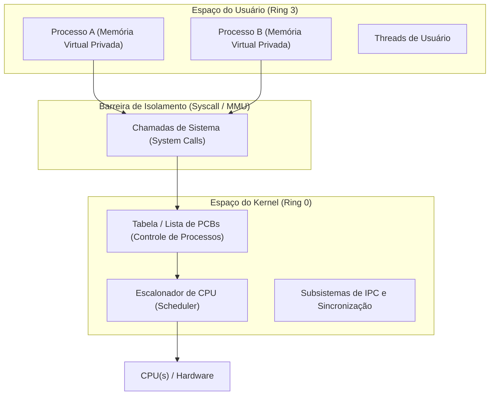
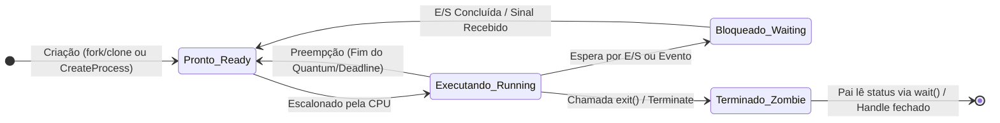

# Estudo de Caso: Gerenciamento de Processos em Sistemas Operacionais
## Análise Comparativa: Windows 11 Pro (23H2/24H2) vs. Ubuntu 24.04 LTS (Kernel Linux 6.8)

**Instituição:** Universidade Federal Rural de Pernambuco (UFRPE)  
**Departamento:** Departamento de Computação (BCC)  
**Disciplina:** Sistemas Operacionais  
**Docente:** Prof. Dr. Douglas Véras  
**Discentes (Dupla):** Luiz Maranhão & Mário Jorge  
**Data:** 2026  

---

## 1. Introdução ao Gerenciamento de Processos

### 1.1 Conceito Fundamental e Importância
No paradigma dos sistemas computacionais modernos, o **processo** constitui a unidade fundamental de execução e gerenciamento de recursos. Enquanto um **programa** é uma entidade passiva — uma sequência estática de instruções binárias gravada em memória secundária (disco rígido ou SSD) —, um **processo** é uma entidade ativa. Ele representa a execução dinâmica desse programa, englobando o contador de programa (*Program Counter* - PC), os conteúdos dos registradores do processador, uma pilha de execução (*stack*), um segmento de dados (*heap* e variáveis globais) e um conjunto de recursos alocados (descritores de arquivos, chaves de segurança e portas de comunicação).

O subsistema de gerenciamento de processos do Sistema Operacional (SO) é responsável por:
1. **Multiprogramação e Compartilhamento de CPU:** Multiplexar a CPU entre múltiplos processos concorrentes, permitindo que processos aguardando operações de Entrada/Saída (E/S) cedam o processador para tarefas prontas.
2. **Proteção e Isolamento:** Garantir que cada processo execute em seu próprio espaço de endereçamento virtual privado, isolado por hardware (MMU), de modo que um erro ou invasão em uma aplicação não comprometa as demais ou o próprio núcleo do sistema (Kernel).
3. **Escalonamento Justo e Previsível:** Distribuir o tempo de processador de forma a otimizar critérios como tempo de resposta, vazão (*throughput*), latência e justiça distributiva.
4. **Comunicação e Sincronização:** Prover primitivas eficientes e seguras para que processos cooperantes possam trocar informações e coordenar acessos a recursos compartilhados sem incorrer em condições de corrida (*race conditions*).

---

### 1.2 O Bloco de Controle de Processo (PCB)
Para coordenar a concorrência, o SO mantém para cada processo ativo uma estrutura de controle denominada **Bloco de Controle de Processo** (*Process Control Block* - PCB). O PCB funciona como a "carteira de identidade" do processo no kernel. 

Durante uma **comutação de contexto** (*context switch*), o SO suspende o processo em execução, salva todos os seus registradores e estado volátil no seu respectivo PCB e carrega os registradores do novo processo a ser despachado a partir do PCB deste último.

Os elementos universais mantidos em um PCB incluem:
- **Identificadores:** PID (*Process Identifier*), PPID (*Parent Process ID*), UID/GID (*User/Group ID*).
- **Estado do Processo:** Pronto (*Ready*), Executando (*Running*), Bloqueado/Esperando (*Waiting/Blocked*), etc.
- **Contexto de Hardware:** Ponteiro de instrução (PC), ponteiro de pilha (SP) e registradores gerais.
- **Parâmetros de Escalonamento:** Prioridade base/dinâmica, ponteiros para filas de prontos e cotas de tempo (*quantum* / *vruntime*).
- **Gerenciamento de Memória:** Ponteiros para diretórios de páginas (CR3 no x86_64), tabelas de segmentos e limites de endereço virtual.
- **Tabela de Arquivos e Recursos:** Vetor de descritores de arquivos abertos, semáforos alocados e portas de rede.

---

## 2. Visão Geral dos Sistemas Comparados

| Característica | Windows 11 Pro (23H2 / 24H2) | Ubuntu 24.04 LTS (Kernel Linux 6.8) |
| :--- | :--- | :--- |
| **Família / Padrão** | Windows NT (versão interna NT 10.0) | Unix-like / POSIX.1 compliance |
| **Arquitetura do Kernel**| Microkernel Híbrido (Executivo integrado em Ring 0) | Monolítico Modular (Módulos dinâmicos LKM em Ring 0) |
| **Unidade Escalonável** | Threads (`KTHREAD` / `ETHREAD`) | Tarefas Leves (`task_struct` / LWP) |
| **Escalonador Padrão** | Preemptivo Multi-queue com Quantum e Intel Thread Director | **EEVDF** (*Earliest Eligible Virtual Deadline First*) |
| **Foco Estratégico** | Interatividade gráfica, compatibilidade Win32/64, hardware heterogêneo | Desempenho de rede, contêineres, servidores e portabilidade |

---

## 3. Matriz Comparativa Detalhada (10 Dimensões)

### 3.1 Informações de um Processo

#### Windows 11 Pro
No Windows NT, o processo é um objeto opaco do Executivo gerenciado pelo subsistema *Object Manager*.
- **Estruturas Centrais:** Bloco `EPROCESS` (Executive Process) que engloba o bloco `KPROCESS` (Kernel Process). Contém:
  - **PID & Session ID:** Identificador numérico do processo e ID da sessão de login gráfica ou remota (RDP).
  - **Token de Segurança (Access Token):** SID do usuário e privilégios associados para controle de acesso discricionário (DACL).
  - **Tabela de Handles:** Ponteiros indiretos para objetos do kernel (arquivos, chaves de registro, eventos, threads).
  - **Working Set:** Conjunto de páginas virtuais atualmente residentes na memória física (RAM).
  - **PEB (Process Environment Block):** Estrutura alocada no espaço do usuário contendo argumentos da linha de comando, variáveis de ambiente e a lista de DLLs carregadas.

#### Ubuntu 24.04 LTS
No Linux, o processo é integralmente representado pela estrutura C `struct task_struct` (definida em `<linux/sched.h>`).
- **Campos Principais:**
  - **PID e TGID:** `pid` (identificador único da tarefa no kernel) e `tgid` (*Thread Group ID*, correspondente ao PID exibido ao usuário).
  - **Credenciais de Segurança (`cred`):** UID, GID, eUID (*effective* UID para binários setuid) e capacidades POSIX.
  - **Espaço de Memória (`mm_struct`):** Descreve as regiões VMA (*Virtual Memory Areas*), código, dados, heap e pilha.
  - **Tabela de Arquivos (`files_struct`):** Vetor de ponteiros para estruturas `struct file` indexadas pelo número do descritor (`fd`).
  - **Contabilidade de Tempo:** `utime` (tempo em modo usuário) e `stime` (tempo em chamadas de sistema no kernel).

---

### 3.2 Modelagem dos Processos

#### Windows 11 Pro
- **Camadas Arquiteturais:** A modelagem é estritamente particionada entre:
  1. *Kernel Layer:* `KPROCESS` mantém a estrutura mínima para despacho de hardware: ponteiro de diretório de tabelas de páginas (registrador CR3 na arquitetura x86_64), máscara de afinidade de CPU e estatísticas de tempo de ciclo.
  2. *Executive Layer:* `EPROCESS` agrega as camadas de abstração do sistema, mantendo a lista encadeada `ActiveProcessLinks` (lista circular duplamente encadeada que une todos os processos ativos no kernel).
  3. *User-Mode Layer:* O `PEB` pode ser lido diretamente pelo processo sem gerar interrupção de kernel (*syscall*), acelerando rotinas da biblioteca de tempo de execução (NTDLL/CRT).

#### Ubuntu 24.04 LTS
- **Centralização em Estrutura Única:** Ao contrário da divisão Windows, o Linux utiliza uma única macroestrutura `task_struct`.
- **Organização no Kernel:**
  1. *Lista Circular Global (`task_list`):* Todos os processos do sistema estão interligados por ponteiros `next_task` e `prev_task`.
  2. *Tabela Hash de PIDs (`pid_hash`):* Permite ao kernel localizar o ponteiro de qualquer processo a partir de seu PID em tempo $O(1)$.
  3. *Árvores Rubro-Negras (Red-Black Trees):* Utilizadas pelo escalonador para ordenar processos prontos com base no tempo de execução virtual e deadline.
  4. *Interface VFS `/proc`:* O kernel projeta a modelagem interna de cada processo como um diretório virtual em `/proc/<PID>/`. Arquivos como `status`, `maps`, `cmdline` e `io` são gerados dinamicamente na leitura.

---

### 3.3 Estados e Transições Possíveis

#### Windows 11 Pro (Estados de Thread)
Como o Windows despacha threads, os estados formais pertencem às threads:
1. **Initialized:** Thread alocada e em configuração.
2. **Ready:** Thread aguardando na fila de prioridade para ser executada.
3. **Standby:** Thread já selecionada para rodar em um núcleo de processamento específico no próximo chaveamento.
4. **Running:** Executando ativamente na CPU.
5. **Waiting:** Bloqueada aguardando evento, semáforo, E/S de disco ou temporizador.
6. **Transition:** Pronta para executar, mas suas páginas de pilha de kernel foram descarregadas para o arquivo de paginação (*pagefile.sys*).
7. **Terminated:** Execução finalizada, aguardando que todas as aplicações fechem seus *handles* abertos para destruição do bloco no kernel.
8. **DeferredReady:** Otimização de nós NUMA multiprocessados.

#### Ubuntu 24.04 LTS (Estados em `task_struct`)
1. **`TASK_RUNNING` (R):** A tarefa está atualmente em execução ou na fila de prontos aguardando a CPU.
2. **`TASK_INTERRUPTIBLE` (S):** Dormindo (*sleeping*) aguardando um recurso; pode ser acordada prematuramente se receber um sinal POSIX.
3. **`TASK_UNINTERRUPTIBLE` (D):** Dormindo em espera de hardware crítico (geralmente E/S de bloco no disco ou driver de rede); **imune a sinais**, inclusive `SIGKILL` (`kill -9`), até que o dispositivo responda.
4. **`TASK_STOPPED` (T):** Execução suspensa propositalmente por sinal de controle de terminal (`SIGSTOP`, `SIGTSTP` / `Ctrl+Z`).
5. **`TASK_TRACED` (t):** Processo pausado sob monitoramento de um depurador externo via chamada `ptrace` (ex.: GDB).
6. **`EXIT_ZOMBIE` (Z):** Processo já concluiu sua execução e liberou sua memória, mas sua entrada na tabela de processos permanece retida até que o processo pai invoque `wait()` ou `waitpid()` para consultar seu código de término (*exit code*).
7. **`EXIT_DEAD` (X):** Estado terminal enquanto a estrutura é desfeita pelo coletor do kernel.

---

### 3.4 Tipo de Threads

#### Windows 11 Pro
- **Modelo 1:1 Nativo (Kernel-Level Threads):** O escalonador do Windows enxerga e despacha exclusivamente threads (`KTHREAD`). Todo processo Win32 nasce com pelo menos uma thread primária. A criação de threads (`CreateThread`) aloca recursos no kernel, garantindo paralelismo real em múltiplos núcleos.
- **Fibras (Fibers - Modelo M:N Cooperativo):** O subsistema Win32 disponibiliza uma API de Fibras (`ConvertThreadToFiber`, `SwitchToFiber`). Fibras operam inteiramente em modo usuário sob agendamento cooperativo sem custo de transição para o kernel. Embora historicamente relevante em engines como Microsoft SQL Server, seu uso hoje é desaconselhado pela própria Microsoft em favor de modelos assíncronos modernos (`async`/`await` e Thread Pools gerenciados).

#### Ubuntu 24.04 LTS
- **Modelo 1:1 Nativo via NPTL (*Native POSIX Thread Library*):** O Linux adota uma abordagem minimalista e elegante: threads são implementadas como **Lightweight Processes (LWPs)**.
- **Unificação no Kernel:** Para o kernel Linux, não existe diferença estrutural essencial entre um processo e uma thread; ambos são instâncias de `task_struct`. A criação é realizada pela chamada de sistema universal `clone()`:
  - Criação de processo tradicional (`fork`): `clone()` com cópia de memória (*Copy-On-Write*).
  - Criação de thread (`pthread_create`): `clone()` com flags `CLONE_VM` (compartilhar espaço de memória), `CLONE_FS` (sistema de arquivos), `CLONE_FILES` (mesma tabela de descritores de arquivo) e `CLONE_SIGHAND` (mesmos manipuladores de sinal).
- Cada thread possui seu identificador único no kernel (`TID`), mas compartilha o mesmo `TGID` (o PID do grupo).

---

### 3.5 Hierarquia e Agrupamento de Processos

#### Windows 11 Pro
- **Ausência de Árvore Genealógica Rígida:** O Windows NT armazena o *Parent Process ID* (Creator PID) no bloco `EPROCESS` apenas como registro histórico no instante da criação. Se o processo pai encerra, o processo filho continua sua execução de maneira completamente autônoma, sem necessidade de adoção (*reparenting*).
- **Agrupamento por Job Objects:** Para gerenciar conjuntos de processos relacionados, o Windows implementa os **Job Objects**. Um Job permite agregar múltiplos processos sob uma única entidade de governança, impondo:
  - Limites compartilhados de porcentagem de CPU.
  - Limite máximo de memória física (*Working Set Limit*).
  - Encerramento em cascata (*Terminate on Job Close*): se o Job for finalizado, todos os processos membros são destruídos instantaneamente. É o mecanismo central utilizado pelo Windows Sandbox, contêineres Windows e pelo navegador Edge para isolar abas.

#### Ubuntu 24.04 LTS
- **Hierarquia Estrita em Árvore Genealógica:** Todo processo no Linux (exceto o processo swapper de PID 0) possui um pai obrigatório. A árvore tem como raiz universal o **PID 1** (`systemd`).
- **Mecanismo de Adoção (*Reparenting*):** Se um processo pai termina antes de seus filhos (produzindo processos órfãos), o kernel Linux reatribui automaticamente esses filhos ao PID 1 ou ao ancestral mais próximo configurado como subreaper (`PR_SET_CHILD_SUBREAPER`), prevenindo processos órfãos permanentes e recolhendo seus status de término para evitar acúmulo de zumbis.
- **Agrupamentos Canônicos:**
  1. *Process Groups (PGID):* Usados pelo shell para associar pipelines de comandos em uma única tarefa em primeiro plano (*foreground*) ou segundo plano (*background*).
  2. *Sessions (SID):* Conjuntos de grupos de processos associados a um terminal de login.
  3. *Control Groups v2 (cgroups):* O mecanismo moderno do Linux para isolamento estrito de recursos (CPU, memória, I/O, rede) que viabiliza ferramentas de contêineres (Docker, Podman, Kubernetes).

---

### 3.6 Comunicação entre Processos (IPC)

| Mecanismo de IPC | Windows 11 Pro | Ubuntu 24.04 LTS |
| :--- | :--- | :--- |
| **Pipes Anônimos** | Unidirecional entre processos com parentesco (`CreatePipe`). | Unidirecional em buffer de kernel (`pipe()` / `\|`). |
| **Pipes Nomeados** | Bidirecionais, operam localmente e em rede corporativa via protocolo SMB (`\\.\pipe\nome`). | FIFOs no sistema de arquivos local (`mkfifo`), unidirecionais. |
| **Memória Compartilhada** | *Section Objects* / Arquivos Mapeados em Memória (`CreateFileMapping` / `MapViewOfFile`). | POSIX (`shm_open`, `mmap`) e System V (`shmget`, `shmat`) montados em `/dev/shm` (tmpfs). |
| **Troca de Mensagens** | ALPC (*Advanced Local Procedure Calls*) para subsistemas NT; Mailslots (broadcast). | Filas de mensagens POSIX (`mq_open`) e System V (`msgget`); D-Bus para serviços de desktop. |
| **Sinais / Notificações** | Não possui sinais POSIX nativos; utiliza eventos de sincronização (`CreateEvent`) e janelas (`SendMessage`). | Sinais assíncronos POSIX (`SIGINT`, `SIGTERM`, `SIGKILL`, `SIGUSR1`). |
| **Sockets Locais** | Winsock em modo loopback (`127.0.0.1`). | *Unix Domain Sockets* (`AF_UNIX`) com alta taxa de transferência diretamente na memória do kernel. |

---

### 3.7 Exclusão Mútua e Sincronização

#### Windows 11 Pro
- **Primitivas em Modo Kernel (Dispatcher Objects):**
  - **Mutexes (Mutants):** Fornecem exclusão mútua interprocessos com suporte a detecção de *thread abandonment*: se a thread dona da trava morre sem liberá-la, o kernel concede a posse à próxima thread na fila com um código de alerta especial (`WAIT_ABANDONED`).
  - **Semáforos:** Controlam acesso a pools finitos de recursos através de contador atômico.
  - **Eventos:** Sinalizadores booleanos (Manual-Reset ou Auto-Reset) usados para notificar threads sobre conclusões assíncronas.
- **Primitivas em Espaço do Usuário:**
  - **Critical Sections:** Muito rápidas; utilizam spinlocks temporários antes de recorrer a uma chamada de sistema se a colisão persistir.
  - **Slim Reader/Writer (SRW) Locks:** Ultraleves (têm o tamanho exato de um ponteiro), não alocam estruturas no kernel e suportam múltiplos leitores concorrentes ou um escritor exclusivo.

#### Ubuntu 24.04 LTS
- **Primitivas em Modo Kernel:**
  - **Mutexes do Kernel (`struct mutex`):** Travas dorminhocas com chaveamento de contexto.
  - **Spinlocks (`spinlock_t`):** Travas de espera ativa (laço `while`) usadas onde o código não pode dormir (como manipuladores de interrupção de hardware - ISRs).
  - **RCU (*Read-Copy-Update*):** Técnica avançada sem travas (*lockless*) onde leitores acessam ponteiros sem qualquer bloqueio ou overhead de barramento de cache, enquanto escritores criam cópias dos dados e atualizam o ponteiro atomicamente após um período de graça (*grace period*).
- **Primitivas em Espaço do Usuário via Futex (*Fast Userspace Mutex*):**
  - O Linux implementa `pthread_mutex_t` sobre a infraestrutura de **futexes**. No caminho ideal (sem colisão), a trava e o destravamento operam 100% no registrador da CPU via instruções atômicas de hardware (`CMPXCHG`), sem cruzar a fronteira de proteção para o kernel. A chamada de sistema `futex()` só é disparada se houver colisão efetiva, garantindo desempenho inigualável.

---

### 3.8 Prioridades de um Processo

#### Windows 11 Pro (Escala de 32 Níveis)
- **Nível 0:** Zero-Page Thread (limpeza de memória RAM em repouso).
- **Níveis 1 a 15 (Prioridades Dinâmicas):** Faixa normal para aplicações de usuário e serviços em segundo plano.
- **Níveis 16 a 31 (Prioridades de Tempo Real):** Processos com privilégios administrativos; suas threads executam com precedência absoluta sobre qualquer processo comum.
- **Classes de Prioridade Win32:**
  - *Idle (4)*, *Below Normal (6)*, *Normal (8)*, *Above Normal (10)*, *High (13)* e *Realtime (24)*.
- **Dynamic Priority Boost:** O Windows aplica aumentos temporários de prioridade para:
  1. *Foreground Boost:* A aplicação cuja janela está em foco do mouse/teclado recebe incremento para garantir sensação de fluidez.
  2. *I/O Boost:* Threads desbloqueadas após leitura de disco ou pacote de rede recebem boost transitório.
  3. *Anti-Starvation (Balance Set Manager):* A cada 4 segundos, threads prontas há mais de 4 segundos sem executar recebem boost para o nível 15 por 2 quantums.

#### Ubuntu 24.04 LTS (Escala de 140 Níveis)
- **Níveis 0 a 99 (Tempo Real - POSIX RT):** Gerenciadas pelas políticas `SCHED_FIFO` e `SCHED_RR`. Prevalecem sobre qualquer tarefa comum.
- **Níveis 100 a 139 (Tempo Compartilhado - Normal):** Gerenciadas pelo escalonador EEVDF sob as políticas `SCHED_OTHER` e `SCHED_BATCH`.
- **Escala Nice (Espaço do Usuário):**
  - Varia de **-20** (prioridade máxima / maior parcela de CPU) a **+19** (prioridade mínima / mais amigável).
  - O valor padrão é **0**, que corresponde matematicamente ao nível de prioridade **120** no kernel.
  - Apenas o superusuário (`root` ou com capacidade `CAP_SYS_NICE`) pode atribuir valores nice negativos.

---

### 3.9 Algoritmo de Escalonamento de Processos

#### Windows 11 Pro: Preemptivo por Prioridade com Suporte Heterogêneo
- **Lógica de Operação:** Escalonador preemptivo guiado por prioridades com múltiplas filas de prontos. A thread pronta de maior prioridade sempre é despachada. Entre threads de mesma prioridade, adota-se rodízio (*Round-Robin*) baseado em fatias de tempo (*Quantum*).
- **Configuração de Quantum:**
  - *Windows 11 Client:* Quantums curtos (cerca de 30 ms com boosts frequentes) para máxima interatividade da interface gráfica.
  - *Windows Server:* Quantums longos (cerca de 120 ms) para minimizar trocas de contexto e elevar o throughput de bancos de dados.
- **Suporte a CPUs Híbridas (Intel Thread Director):**
  - O Windows 11 trabalha em conjunto com o microcódigo dos processadores modernos (Intel Core de 12ª a 14ª geração e CPUs heterogêneas ARM/AMD). O SO recebe telemetria de hardware sobre as classes de instruções em execução e direciona:
    - Tarefas pesadas e de primeiro plano para núcleos de Performance (**P-cores**).
    - Tarefas em segundo plano e serviços silenciosos para núcleos de Eficiência (**E-cores**).

#### Ubuntu 24.04 LTS: Escalonador EEVDF (*Earliest Eligible Virtual Deadline First*)
- **A Transição do CFS para o EEVDF:** Desde o Linux 2.6.23 até a versão 6.5, o Linux utilizou o **CFS** (*Completely Fair Scheduler*), que ordenava tarefas por tempo de execução virtual (`vruntime`) em uma árvore rubro-negra. O CFS era excepcionalmente justo no longo prazo, mas apresentava instabilidades de latência para tarefas interativas.
- **Fundamento Teórico do EEVDF:** Proposto originalmente por Peter Hoon em 1995 e oficializado no Kernel Linux 6.6+, o EEVDF atinge maturidade no Ubuntu 24.04 LTS (Kernel 6.8). O algoritmo separa conceitualmente:
  1. **Elegibilidade (*Eligibility*):** Verifica se a tarefa já consumiu ou não a cota de CPU a que tinha direito até o momento virtual atual.
  2. **Deadline Virtual (*Virtual Deadline*):** Determina a urgência temporal da tarefa. Tarefas com requisitos de baixa latência (como processos de interface ou áudio) recebem prazos virtuais mais curtos e furam a fila de execução sem necessitar de privilégios de tempo real ou quebrar a justiça distributiva global.
- **Políticas POSIX RT Suportadas:** `SCHED_FIFO` (executa até término ou preempção superior), `SCHED_RR` (rodízio em tempo real) e `SCHED_DEADLINE` (Earliest Deadline First para tarefas periódicas rígidas).

---

### 3.10 Tratamento de Deadlocks

#### Windows 11 Pro
- **Abordagem Central: Algoritmo do Avestruz (*Ostrich Algorithm*):**
  O Windows não adota algoritmos preventivos ou de detecção contínua em tempo de execução para aplicações gerais de usuário. A justificativa de engenharia é o custo proibitivo de overhead computacional: manter matrizes de alocação de recursos e executar o Algoritmo do Banqueiro a cada requisição de lock tornaria o sistema inviável.
- **Ferramentas de Diagnóstico e Prevenção:**
  1. **Wait Chain Traversal (WCT):** API nativa do Windows que percorre os nós de sincronização (COM, ALPC, Critical Sections) e localiza grafos cíclicos de bloqueio, permitindo diagnosticar exatamente quais threads e processos estão em impasse.
  2. **Driver Verifier (`verifier.exe`):** Módulo em nível de kernel projetado para desenvolvedores e administradores; ativa a verificação rigorosa de travas de drivers, forçando a detecção preventiva de deadlocks antes que corrompam o sistema.

#### Ubuntu 24.04 LTS
- **Abordagem Central: Algoritmo do Avestruz no Espaço do Usuário:**
  Similarmente, o Linux não resolve deadlocks de aplicações de usuário de forma autônoma; o processo em impasse permanece bloqueado até a intervenção do usuário ou de um watchdog.
- **Ferramentas de Diagnóstico e Prevenção no Kernel:**
  1. **Lockdep (*Lock Dependency Validator*):** Componente extraordinário do kernel Linux (ativado em kernels de depuração). Ele valida as regras de ordenação de aquisição de travas em tempo de execução. Se um módulo adquire a trava A antes de B e em outro ponto adquire B antes de A, o Lockdep emite um alerta grave no `dmesg` acusando potencial deadlock antes mesmo de o evento ocorrer.
  2. **Hung Task Detector:** Monitor em segundo plano que varre periodicamente as tarefas em estado `TASK_UNINTERRUPTIBLE` (D). Se uma tarefa permanecer travada por mais de 120 segundos, o kernel grava um despejo de pilha completo (*call trace*) nos logs do sistema para facilitar a depuração.

---

## 4. Guia Prático de Comandos e Procedimentos

### 4.1 Windows 11 Pro (CLI & GUI)

| Objetivo / Tarefa | Linha de Comando (PowerShell / CMD) | Procedimento Gráfico (GUI) |
| :--- | :--- | :--- |
| **Listar processos em execução** | `Get-Process \| Sort-Object CPU -Descending` / `tasklist /v` | Pressionar `Ctrl + Shift + Esc` (Gerenciador de Tarefas) -> Aba "Detalhes". |
| **Inspecionar processo específico**| `Get-Process -Id <PID> \| Format-List *` | Gerenciador de Tarefas -> Botão direito no processo -> "Propriedades". |
| **Visualizar threads de um processo**| `(Get-Process -Id <PID>).Threads \| Select Id, Priority, State` | Sysinternals Process Explorer -> Duplo clique no processo -> Aba "Threads". |
| **Verificar árvore genealógica**| `Get-CimInstance Win32_Process \| Select ProcessId, ParentProcessId, Name` | Process Explorer -> Exibição padrão organiza processos em árvore (*Tree View*). |
| **Alterar prioridade de processo**| `(Get-Process -Name notepad).PriorityClass = 'High'` / `start /high notepad.exe` | Gerenciador de Tarefas -> Aba Detalhes -> Botão direito -> "Definir prioridade". |
| **Analisar deadlock / Cadeia de Espera**| `taskkill /F /PID <PID>` (para encerrar processo em deadlock) | `resmon.exe` -> Aba CPU -> Botão direito no processo -> "Analisar Cadeia de Espera". |
| **Inspecionar Named Pipes**| `Get-ChildItem \\.\pipe\` | Executar ferramenta `pipelist.exe` do pacote Sysinternals. |

---

### 4.2 Ubuntu 24.04 LTS (CLI & GUI)

| Objetivo / Tarefa | Linha de Comando (Terminal) | Procedimento Gráfico (GUI) |
| :--- | :--- | :--- |
| **Listar processos em execução** | `ps aux` ou `ps -ef --sort=-%cpu` | Abrir aplicativo "Monitor do Sistema" (`gnome-system-monitor`) -> Aba Processos. |
| **Monitoramento interativo**| `top` ou `htop` (F6 para ordenar por CPU/MEM) | Monitor do Sistema -> Ordenar colunas clicando no cabeçalho. |
| **Inspecionar processo no kernel** | `cat /proc/<PID>/status` / `cat /proc/<PID>/maps` | Monitor do Sistema -> Botão direito no processo -> "Propriedades" / "Mapeamento de memória". |
| **Visualizar threads (LWPs)** | `ps -eLf \| grep <PID>` / `top -H -p <PID>` / `ls /proc/<PID>/task/` | Monitor do Sistema -> Detalhes do processo. |
| **Visualizar árvore genealógica**| `pstree -p` ou `ps -ef --forest` ou `systemd-cgls` | Monitor do Sistema -> Menu superior -> Selecionar modo "Dependências de Processos". |
| **Alterar prioridade (Nice)** | `nice -n -10 ./app` (iniciar) / `renice -n 5 -p <PID>` (em execução) | Monitor do Sistema -> Botão direito no processo -> "Mudar Prioridade". |
| **Controlar estados (Pausar/Retomar)**| `kill -STOP <PID>` (pausa) e `kill -CONT <PID>` (retoma) | Monitor do Sistema -> Botão direito -> "Pausar" / "Continuar". |
| **Finalizar processo em deadlock**| `kill -9 <PID>` ou `pkill -9 -f <nome_processo>` | Monitor do Sistema -> Botão direito -> "Matar Processo" (`SIGKILL`). |
| **Inspecionar IPC e Locks** | `ipcs -a` (System V IPC) / `ls -la /dev/shm` / `lslocks` (locks ativos) | Visualização via logs em `dmesg` ou depurador de código. |

---

## 5. Conclusões e Síntese da Análise

A comparação minuciosa entre o **Windows 11 Pro** e o **Ubuntu 24.04 LTS** evidencia tanto a **convergência conceitual** quanto a **distinção filosófica** no projeto de sistemas operacionais modernos:

1. **Convergência Fundamental para o Modelo 1:1:** Ambos os sistemas abandonaram a premissa de múltiplos modelos concorrentes de threads em favor de threads nativas despachadas em modo kernel (1:1). Isso reflete a consolidação da arquitetura multicore contemporânea, onde o hardware demanda paralelismo real de registradores e caches.
2. **Abstração vs. Uniformidade:**
   - O **Windows** opta por uma arquitetura em camadas ricas orientada a objetos (Object Manager, EPROCESS, KPROCESS, PEB, Security Tokens), oferecendo um ecossistema corporativo estável com agrupamento por Job Objects e suporte otimizado a interfaces gráficas interativas e chips híbridos (P/E cores).
   - O **Linux** preserva o princípio Unix clássico da simplicidade elegante: unifica processos e threads sob uma única entidade primitiva (`task_struct`), projeta todo o estado de execução no sistema virtual de arquivos (`/proc`) e estrutura a concorrência em uma árvore genealógica estrita enraizada no `systemd`.
3. **Inovação no Escalonamento:** Enquanto o Windows aperfeiçoa o agendamento direcionado por telemetria de hardware (Thread Director), o Linux dá um salto científico com a implementação do **EEVDF**, demonstrando que a separação entre elegibilidade e deadline virtual é o caminho mais eficaz para equilibrar tarefas interativas de latência crítica com processamento massivo em servidores e contêineres.

---

## 6. Referências Bibliográficas e Científicas

1. **SILBERSCHATZ, Abraham; GALVIN, Peter B.; GAGNE, Greg.** *Operating System Concepts*. 10. ed. Hoboken: John Wiley & Sons, 2018. (Capítulos 3: Processes, 4: Threads, e 5: CPU Scheduling).
2. **TANENBAUM, Andrew S.; BOS, Herbert.** *Sistemas Operacionais Modernos*. 4. ed. São Paulo: Pearson Education do Brasil, 2015. (Capítulo 2: Processos e Threads, e Capítulo 6: Deadlocks).
3. **RUSSINOVICH, Mark E.; SOLOMON, David A.; IONESCU, Alex.** *Windows Internals: Part 1 - System architecture, processes, threads, memory management, and more*. 7. ed. Redmond: Microsoft Press, 2017.
4. **LOVE, Robert.** *Linux Kernel Development*. 3. ed. Boston: Addison-Wesley Professional, 2010. (Capítulo 3: Process Management, e Capítulo 4: Process Scheduling).
5. **STALLINGS, William.** *Operating Systems: Internals and Design Principles*. 9. ed. Boston: Pearson, 2018.
6. **HOON, Peter.** *EEVDF: An Earliest Eligible Virtual Deadline First scheduling algorithm*. IEEE Transactions on Real-Time Systems, 1995. (Documentação oficial do Kernel Linux 6.6+, 2023-2024).
7. **CORBET, Jonathan; RUBINI, Alessandro; KROAH-HARTMAN, Greg.** *Linux Device Drivers*. 3. ed. Sebastopol: O'Reilly Media, 2005.
8. **MICROSOFT LEARN.** *About Processes and Threads*. Disponível em: <https://learn.microsoft.com/en-us/windows/win32/procthread/about-processes-and-threads>. Acesso em: 2026.
