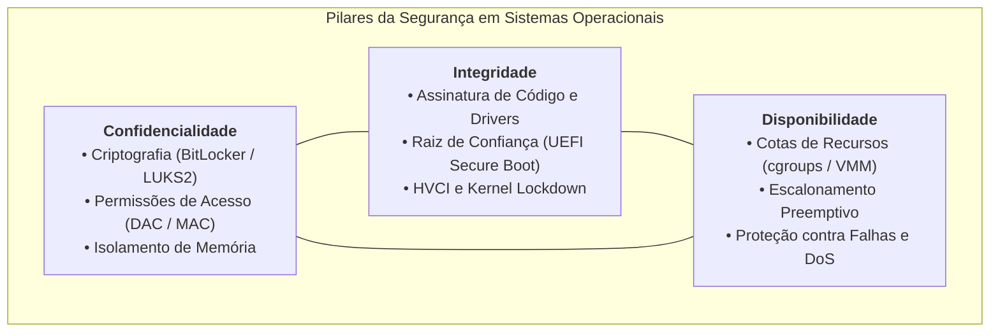
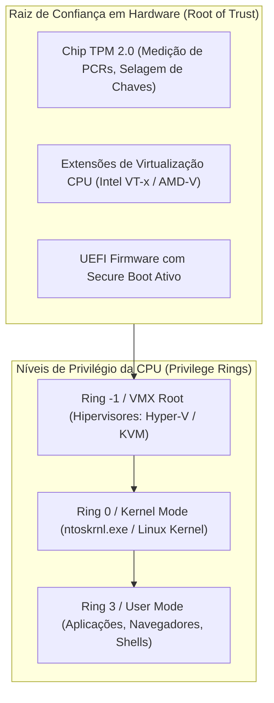
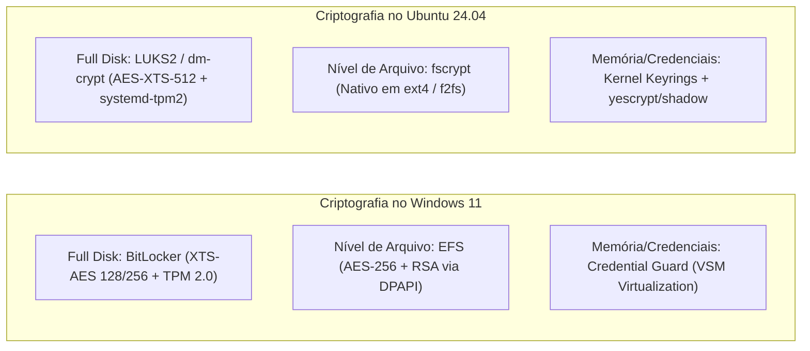
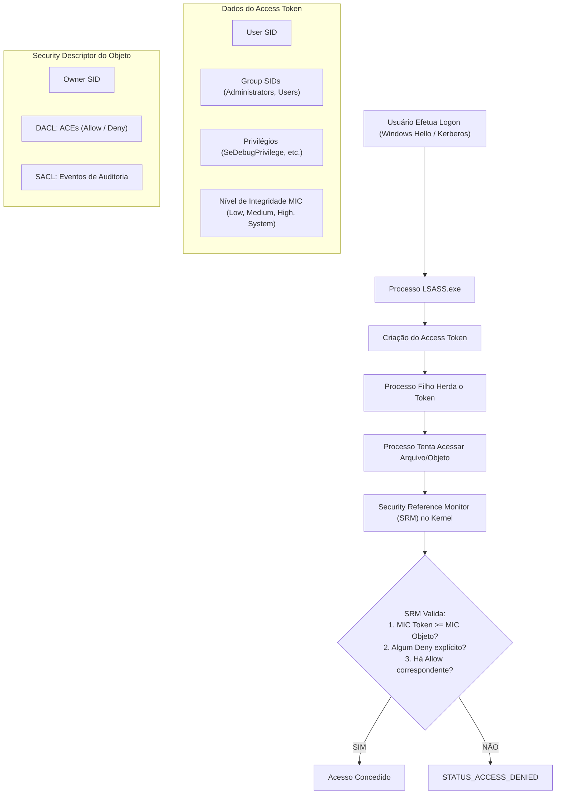
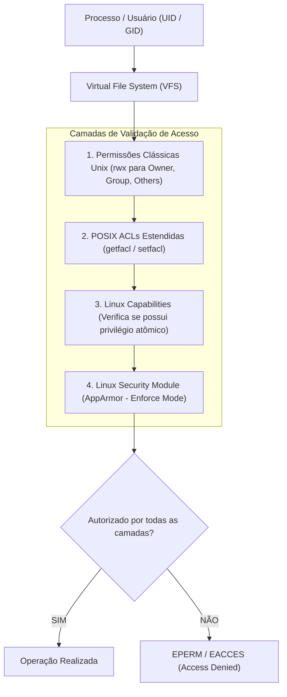
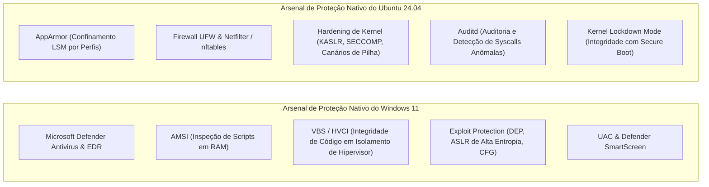

# Estudo de Caso: Segurança e Proteção em Sistemas Operacionais
## Análise Comparativa: Windows 11 Pro (23H2/24H2) vs. Ubuntu 24.04 LTS (Kernel Linux 6.8)

**Instituição:** Universidade Federal Rural de Pernambuco (UFRPE)  
**Departamento:** Departamento de Computação (BCC)  
**Disciplina:** Sistemas Operacionais  
**Docente:** Prof. Dr. Douglas Véras  
**Discentes (Dupla):** Luiz Maranhão & Mário Jorge  
**Data:** Outubro de 2026  

---

## 1. Introdução à Segurança nos Sistemas Operacionais

A segurança e a proteção de sistemas computacionais constituem pilares primordiais no projeto de sistemas operacionais modernos. Em sua essência, um sistema operacional gerencia recursos compartilhados de hardware e software entre múltiplos processos e múltiplos usuários. Consequentemente, o SO deve atuar como uma autoridade confiável (*Trusted Computing Base* - TCB), garantindo que nenhum processo possa violar as barreiras de isolamento impostas pelo núcleo ou acessar recursos para os quais não possua autorização explícita.

### 1.1 A Tríade CIA / CID e Objetivos Complementares
Os requisitos fundamentais de segurança em SOs apoiam-se no consagrado modelo da **Tríade CIA** (ou CID, em português):

1. **Confidencialidade (*Confidentiality*):** Garantia de que informações armazenadas em disco, transmitidas na rede ou residentes na memória RAM sejam acessíveis exclusivamente a identidades autorizadas.
2. **Integridade (*Integrity*):** Salvaguarda contra modificações, corrupções ou inserções não autorizadas no sistema de arquivos, configurações e código executável de kernel e usuário.
3. **Disponibilidade (*Availability*):** Garantia de que os serviços essenciais, o processamento e o acesso aos dados permaneçam funcionais e operacionais mesmo sob condições adversas, falhas de hardware ou tentativas de ataque de negação de serviço (*Denial of Service* - DoS).

Além da tríade primordial, os projetos modernos incorporam:
- **Autenticidade:** Garantia irrefutável da identidade de um sujeito (humano ou processo).
- **Não-repúdio (Irretratabilidade):** Incapacidade de uma entidade negar a autoria de uma operação realizada.
- **Auditoria / Rastreabilidade:** Registro perene de eventos de segurança relevantes para investigação forense.

---

### 1.2 Princípios de Projeto de Segurança (Saltzer & Schroeder)
Em 1975, Jerome Saltzer e Michael Schroeder formularam oito princípios de projeto fundamentais para a proteção da informação em sistemas computacionais, os quais permanecem contemporâneos e norteiam tanto a arquitetura do núcleo NT do Windows quanto o Kernel Linux:

1. **Menor Privilégio (*Principle of Least Privilege - PoLP*):** Todo programa e usuário deve operar com o menor conjunto de privilégios estritamente necessário para cumprir sua tarefa.
2. **Mediação Completa (*Complete Mediation*):** Toda tentativa de acesso a qualquer recurso deve ser interceptada e verificada pelo mecanismo de autorização (implementado pelo VFS/LSM no Linux e pelo Gerenciador de Objetos/Monitor de Referência de Segurança no Windows).
3. **Economia de Mecanismo (*Economy of Mechanism*):** O projeto do mecanismo de segurança deve ser o mais simples e conciso possível para viabilizar validação e reduzir brechas.
4. **Defesa em Profundidade (*Defense in Depth*):** A segurança não deve depender de uma única linha de barreira; múltiplas camadas independentes devem ser sobrepostas.
5. **Separação de Privilégios (*Separation of Privilege*):** Operações críticas devem exigir mais de uma condição para autorização (ex.: autenticação multifator ou múltiplas chaves).
6. **Mecanismo Aberto (*Open Design*):** A segurança não deve depender da obscuridade do projeto (Princípio de Kerckhoffs).

---

### 1.3 Anéis de Proteção da CPU e Raiz de Confiança em Hardware
A imposição das barreiras de segurança de software requer suporte direto da microarquitetura do processador:

- **Ring 0 (Modo Kernel / Supervisor):** Instruções privilegiadas de controle de hardware, manipulação da tabela de páginas MMU e acesso irrestrito à memória física.
- **Ring 3 (Modo Usuário):** Instruções restritas. Todo acesso a arquivos, dispositivos ou rede requer a execução de uma instrução especial de *System Call* (`syscall` / `sysenter`) para transferir o fluxo de controle de forma controlada ao kernel.
- **Ring -1 (Modo Hipervisor / VMX Root):** Permite criar partições virtuais seguras (*Virtual Secure Mode* no Windows ou microVMs confidenciais no Linux), isolando credenciais críticas mesmo se o próprio kernel Ring 0 for comprometido.

---

## 2. Principais Ameaças Sofridas pelos SOs (Pontos Fracos e Superfície de Ataque)

| Vetor de Ameaça / Aspecto | Windows 11 Pro (23H2 / 24H2) | Ubuntu 24.04 LTS (Kernel Linux 6.8) |
| :--- | :--- | :--- |
| **Principal Alvo e Ambiente Típico** | Estações de trabalho corporativas, endpoints de usuários, redes Active Directory corporativas. | Servidores de produção em nuvem pública (AWS, Azure, GCP), clusters Kubernetes, contêineres e roteadores. |
| **Ameaças Predominantes** | Ransomware focado em sequestro de dados empresariais, cavalos de troia bancários, phishing e engenharia social. | Varreduras automatizadas de portas na Internet, ataques de força bruta contra serviços SSH, exploração de APIs web. |
| **Vetor de Ataque a Nível de Kernel** | **BYOVD (*Bring Your Own Vulnerable Driver*):** Invasores instalam drivers de terceiros assinados pela Microsoft, mas vulneráveis, para desativar antivírus em Ring 0. | **Local Privilege Escalation (LPE):** Exploração de bugs de corrupção de memória no kernel (ex.: falhas históricas como Dirty COW, Dirty Pipe, use-after-free em netfilter). |
| **Evasão e Técnicas de Persistência** | **LOLBins (*Living off the Land Binaries*):** Abuso de utilitários legítimos (`certutil`, `powershell`, `mshta`) para executar payloads sem gerar alarmes. | **Binários SUID / GTFOBins:** Abuso de privilégios root herdados em binários comuns com brechas de execução de shell (`/bin/sh`). |
| **Roubo de Credenciais** | Extração de senhas em memória do processo `lsass.exe` (Mimikatz, Pass-the-Hash, Kerberoasting). | Acesso indevido a chaves privadas SSH desprotegidas e arquivos `.env` ou hashes em `/etc/shadow`. |
| **Isolamento de Cargas de Trabalho** | Sandbox de AppContainer e Windows Sandbox baseado em Hyper-V containers. | Falhas de configuração de contêineres Docker (`--privileged`) permitindo *Container Escape* para o host. |

---

## 3. Técnicas de Criptografia Aplicadas

### 3.1 Criptografia de Volume Completo (*Full Disk Encryption - FDE*)
- **Windows 11 (BitLocker):** Opera entre o sistema de arquivos e a controladora de disco. Utiliza o algoritmo padrão **XTS-AES** com chave de 128 ou 256 bits. O BitLocker integra-se intimamente com o chip **TPM 2.0**: durante o boot medido (*Measured Boot*), o TPM avalia os registradores de configuração de plataforma (**PCRs 7 e 11**). Caso a UEFI, a tabela de partição ou os arquivos de boot tenham sido modificados por um bootkit ou atacante offline, a chave mestra de descriptografia (VMK) não é liberada.
- **Ubuntu 24.04 (LUKS2 / dm-crypt):** O módulo `dm-crypt` do kernel provê criptografia transparente de blocos. A especificação **LUKS2** armazena metadados flexíveis, suportando múltiplos slots de chaves derivados com a função de memória intensiva **Argon2id**. No Ubuntu 24.04, o utilitário `systemd-cryptenroll` vincula o volume LUKS2 aos PCRs do TPM 2.0 (PCRs 0, 2 e 7), fornecendo boot medido e desbloqueio automatizado idêntico ao BitLocker, dispensando digitação de senha na inicialização.

### 3.2 Criptografia em Nível de Arquivo e Diretório
- **Windows 11 (EFS - *Encrypting File System*):** Integrado ao NTFS. Utiliza arquitetura de criptografia híbrida: cada arquivo recebe uma chave simétrica aleatória **FEK** (*File Encryption Key*). A FEK é encriptada com a chave pública assimétrica RSA do certificado pessoal do usuário e salva em fluxos de dados alternativos do arquivo. O gerenciamento de chaves é feito pela API DPAPI (*Data Protection API*).
- **Ubuntu 24.04 (fscrypt):** O `fscrypt` oferece criptografia por diretório sem o overhead de montar imagens de disco virtuais. Suportado nativamente pelo sistema de arquivos **ext4**, cada diretório protegido usa uma chave de derivação criptografada com a senha do usuário ou ligada ao módulo PAM.

---

## 4. Autenticação e Controle de Acesso aos Dados

### 4.1 Windows 11: Tokens, SIDs, DACLs e MIC
A arquitetura de segurança do Windows 11 é centrada em objetos e identificadores de segurança:

- **MIC (*Mandatory Integrity Control*):** Complementa o DAC. Atribui 4 níveis de integridade: *Low* (processos sandboxed como navegadores), *Medium* (usuários convencionais), *High* (administradores elevados via UAC) e *System* (processos do kernel). Impede que malwares rodando em nível médio escrevam ou injetem código em processos de nível alto (*No-Write-Up*).

---

### 4.2 Ubuntu 24.04: UIDs, POSIX ACLs, Capabilities e AppArmor
O Linux adota uma abordagem em camadas:

- **Linux Capabilities:** Em vez do modelo tradicional onde o UID 0 (root) possui poder absoluto e destrutivo, o Linux moderno fragmenta os privilégios de superusuário em mais de 40 capacidades independentes (`CAP_NET_BIND_SERVICE` para bind em portas baixas, `CAP_DAC_OVERRIDE` para ignorar checagens de permissão de arquivo, `CAP_SYS_ADMIN`, etc.). Binários podem ser dotados de uma capacidade específica sem precisar executar com bit SUID root ativo.
- **AppArmor (Mandatory Access Control):** Confinamento obrigatório baseado em caminhos absolutos de arquivos. Mesmo que uma vulnerabilidade de execução remota de código ocorra em um serviço como Apache ou servidor SSH, o perfil do AppArmor confina o processo, impedindo-o de ler chaves privadas, acessar outros diretórios ou abrir terminais.

---

## 5. Ferramentas do Próprio SO contra Malware

### 5.1 O Papel Crítico do AMSI no Windows 11
Historicamente, invasores usavam scripts em PowerShell, VBScript ou JavaScript ofuscados com múltiplas camadas de codificação em Base64 e criptografia reversa para evadir antivírus estáticos em disco. O **AMSI (*Antimalware Scan Interface*)** revolucionou essa defesa: integrado ao motor do PowerShell e ao runtime de scripts do Windows, o interpretador executa todos os passos de desofuscação na memória RAM e, **imediatamente antes de executar o comando final**, envia o buffer de texto claro diretamente ao Microsoft Defender para análise heurística e comportamental.

### 5.2 O Papel do SECCOMP e AppArmor no Ubuntu 24.04
No ecossistema Linux, o **SECCOMP (*Secure Computing Mode*)** permite que qualquer aplicação declare ao kernel uma lista estrita de quais chamadas de sistema (*syscalls*) ela está autorizada a realizar. Se um malware explorar um buffer overflow dentro de um servidor web e tentar invocar a syscall `execve` para abrir uma shell interativa, o kernel intercepta a violação e finaliza o processo instantaneamente com sinal `SIGSYS`.

---

## 6. Quadro Sinóptico de Comandos Relevantes

| Categoria de Diagnóstico / Ação | Comandos no Windows 11 Pro (PowerShell / CMD) | Comandos no Ubuntu 24.04 LTS (Bash / Shell) |
| :--- | :--- | :--- |
| **Identidade e Privilégios Ativos** | `whoami /all` `whoami /priv` | `id` `sudo -l` `sudo getcap -r /usr/bin/` |
| **Integridade de Inicialização e Hardware** | `Confirm-SecureBootUEFI` `Get-Tpm` `msinfo32.exe` | `mokutil --sb-state` `systemd-analyze security` `cat /sys/kernel/security/lockdown` |
| **Auditoria e Status de Criptografia** | `manage-bde -status` `Get-BitLockerVolume -MountPoint "C:"` `cipher /c "arquivo.txt"` | `sudo cryptsetup status dm_crypt-0` `sudo cryptsetup luksDump /dev/nvme0n1p3` `systemd-cryptenroll --tpm2-device=list` |
| **Controle de Acesso a Arquivos** | `icacls "C:\Pasta" /t` `secedit /export /cfg C:\secpol.inf` | `ls -l /caminho/arquivo` `getfacl /caminho/arquivo` `sudo setfacl -m u:aluno:rwx arquivo` |
| **Status de Proteção Antimalware / EDR** | `Get-MpComputerStatus` `Start-MpScan -ScanType QuickScan` `Get-ProcessMitigation -System` | `sudo aa-status` `sudo ufw status verbose` `sudo ausearch -m avc -ts recent` |
| **Auditoria de Conexões de Rede Suspeitas** | `netstat -ano \| findstr LISTENING` `Get-NetTCPConnection -State Listen` | `ss -tulpen` `sudo netstat -tlpn` |
| **Auditoria de Tentativas de Invasão / Logs** | `Get-WinEvent -FilterHashtable @{LogName='Security'; Id=4624,4625} -MaxEvents 15` | `sudo journalctl -u ssh -g "Failed password" -n 15` `sudo lastb -n 10` |

---

## 7. Conclusão Comparativa

A comparação entre o **Windows 11 Pro** e o **Ubuntu 24.04 LTS** evidencia filosofias arquiteturais distintas que convergem para um alto nível de maturidade e robustez:

- O **Windows 11 Pro** adota uma abordagem de **Segurança Centrada em Hardware e Hipervisor (Zero Trust)**. Ao transformar requisitos como TPM 2.0, Secure Boot e VBS/HVCI em padrões obrigatórios de fábrica, o sistema isola o código do kernel e os segredos do processo LSASS em ambientes de hardware blindados. Sua defesa é predominantemente proativa e assistida por inteligência de ameaças em nuvem (Microsoft Defender EDR e AMSI), necessária diante de sua gigantesca base de endpoints exposta a ransomware.
- O **Ubuntu 24.04 LTS** apoia-se na tradicional **Modularidade Unix e Confinamento Obrigatório (Mediação Completa)**. Através da fragmentação do superusuário root com Linux Capabilities, controle mandatário via AppArmor, restrição de chamadas de sistema com SECCOMP e criptografia de disco robusta com LUKS2 e dm-crypt acoplada a TPM 2.0, o Linux oferece aos administradores um ambiente altamente personalizável, transparente e endurecido (*hardened*) para sustentar cargas de trabalho críticas em nuvem e servidores de alta performance.

Ambos os sistemas demonstram que a segurança contemporânea não pode depender exclusivamente de barreiras em nível de aplicação: a simbiose entre microarquitetura de processador, firmware seguro e isolamento no nível de kernel é indispensável para conter as ameaças cibernéticas do século XXI.

---

## 8. Referências Bibliográficas (Normas ABNT)

1. CENTER FOR INTERNET SECURITY. **CIS Microsoft Windows 11 Enterprise Benchmark v3.0.0**. East Greenbush: CIS, 2024. Disponível em: <https://www.cisecurity.org/cis-benchmarks/>. Acesso em: 18 out. 2026.
2. CENTER FOR INTERNET SECURITY. **CIS Ubuntu Linux 24.04 LTS Benchmark v1.0.0**. East Greenbush: CIS, 2024. Disponível em: <https://www.cisecurity.org/cis-benchmarks/>. Acesso em: 18 out. 2026.
3. KERRISK, Michael. **The Linux Programming Interface: A Linux and UNIX System Programming Handbook**. San Francisco: No Starch Press, 2010. 1552 p.
4. LOVE, Robert. **Linux Kernel Development**. 3. ed. Upper Saddle River: Addison-Wesley Professional, 2010. 440 p.
5. MICROSOFT CORPORATION. **Windows Security Documentation & Architecture Guide**. Redmond: Microsoft Learn, 2024. Disponível em: <https://learn.microsoft.com/en-us/windows/security/>. Acesso em: 18 out. 2026.
6. NATIONAL INSTITUTE OF STANDARDS AND TECHNOLOGY. **NIST SP 800-147: BIOS Protection Guidelines**. Gaithersburg: NIST, 2011. DOI: 10.6028/NIST.SP.800-147.
7. NATIONAL INSTITUTE OF STANDARDS AND TECHNOLOGY. **NIST SP 800-193: Platform Firmware Resiliency Guidelines**. Gaithersburg: NIST, 2018. DOI: 10.6028/NIST.SP.800-193.
8. RUSCHINOVICH, Mark E.; SOLOMON, David A.; IONESCU, Alex. **Windows Internals, Part 1: System architecture, processes, threads, memory management, and more**. 7. ed. Redmond: Microsoft Press, 2017. 800 p.
9. RUSCHINOVICH, Mark E.; IONESCU, Alex. **Windows Internals, Part 2: Addressing Infrastructure, Storage, File Systems, and More**. 7. ed. Redmond: Microsoft Press, 2021. 768 p.
10. SALTZER, Jerome H.; SCHROEDER, Michael D. The protection of information in computer systems. **Proceedings of the IEEE**, v. 63, n. 9, p. 1278-1308, 1975. DOI: 10.1109/PROC.1975.9939.
11. SILBERSCHATZ, Abraham; GALVIN, Peter Baer; GAGNE, Greg. **Operating System Concepts**. 10. ed. Hoboken: John Wiley & Sons, 2018. 1040 p.
12. STALLINGS, William. **Sistemas Operacionais: Projetos e Princípios Internos**. 7. ed. São Paulo: Pearson Education do Brasil, 2012. 792 p.
13. TANENBAUM, Andrew S.; BOS, Herbert. **Sistemas Operacionais Modernos**. 4. ed. São Paulo: Pearson Education do Brasil, 2016. 864 p.
14. THE LINUX KERNEL ORGANIZATION. **The Linux Kernel Documentation: Security Subsystems (AppArmor, LSM, Lockdown)**. Release 6.8, 2024. Disponível em: <https://docs.kernel.org/security/>. Acesso em: 18 out. 2026.
